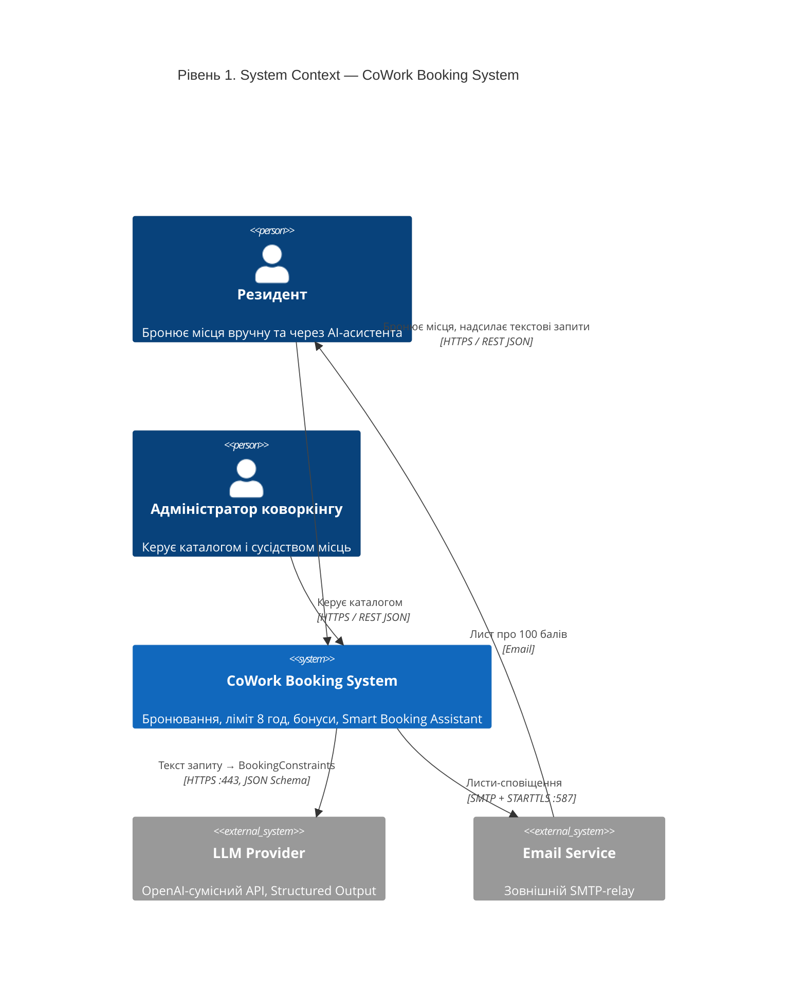
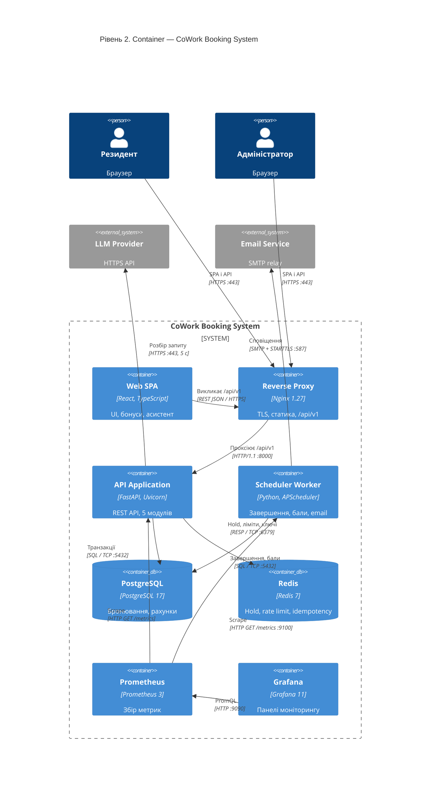
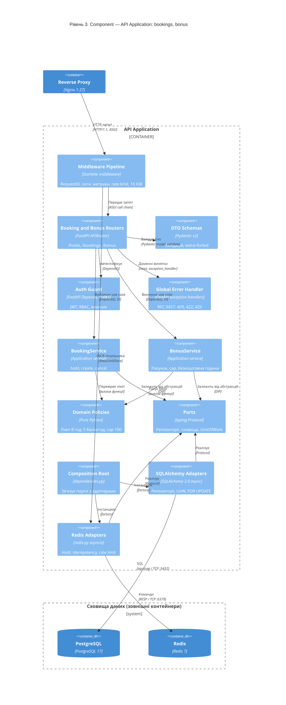
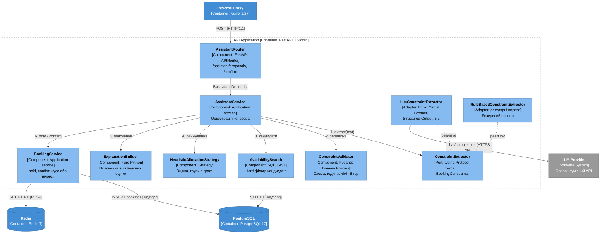
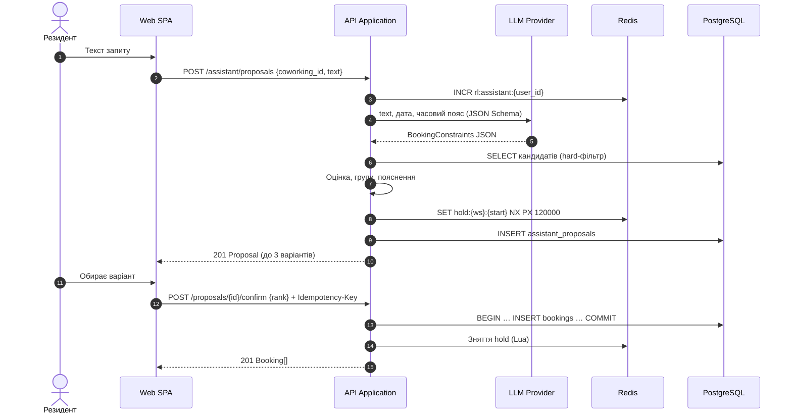
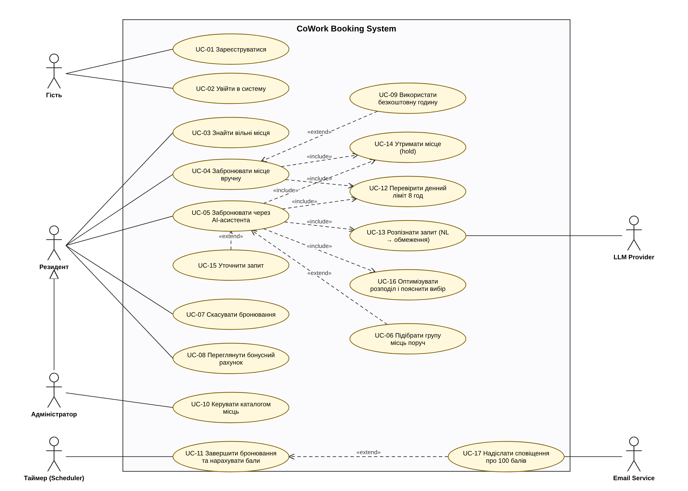
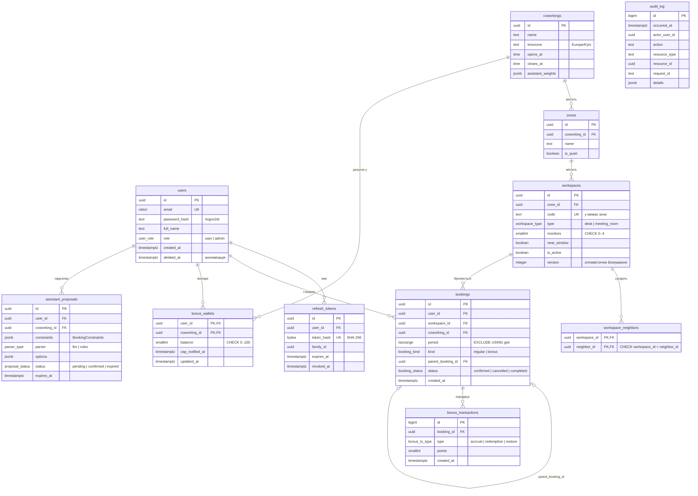

# РОЗДІЛ 2. ПРОЄКТУВАННЯ АРХІТЕКТУРИ СИСТЕМИ

Розділ описує архітектуру вебсистеми бронювання робочих місць у коворкінгу CoWork Booking System. Вихідними даними є контракт вимог [SRS](srs.md) (34 функціональні вимоги, 14 бізнес-правил, 30 нефункціональних вимог), технічне завдання [proposal.md](proposal.md) та журнал архітектурних рішень [ADR](adr/README.md). Діаграми C4 Model описано мовою Mermaid.js за принципом Diagrams-as-Code; контракт API — у специфікації [OpenAPI 3.1](api/openapi.yaml); модель варіантів використання — у файлі StarUML [usecase.mdj](uml/usecase.mdj).

Структура розділу:

| Підрозділ | Зміст | Артефакт |
| --- | --- | --- |
| [2.1](#21-архітектурний-стиль-і-патерни-проєктування) | Архітектурний стиль і патерни проєктування | ADR-001…ADR-004 |
| [2.2](#22-контекстне-та-контейнерне-моделювання-c4-рівні-12) | C4 Model, рівні 1–2 | Mermaid C4Context, C4Container |
| [2.3](#23-компонентне-моделювання-та-серверне-ядро-c4-рівень-3) | C4 Model, рівень 3, серверне ядро Inbound → Core → Outbound | Mermaid C4Component |
| [2.4](#24-безпека-застосунку-appsec) | Безпека застосунку (AppSec) | Матриця контролів OWASP |
| [2.5](#25-топологія-api-та-потоки-даних) | Топологія API та потоки даних | [openapi.yaml](api/openapi.yaml) |
| [2.6](#26-моделювання-варіантів-використання) | Варіанти використання (Use Case) | [usecase.mdj](uml/usecase.mdj), специфікації UC-04, UC-05, UC-09 |
| [2.7](#27-логічна-модель-даних-erd) | Логічна модель даних (ERD) | Mermaid erDiagram |
| [2.8](#28-аудит-інтеграції-артефактів-і-готовність-до-реалізації) | Аудит інтеграції артефактів і готовність до реалізації | Матриця трасування |

## 2.1 Архітектурний стиль і патерни проєктування

### 2.1.1 Вибір архітектурного стилю

Для системи обрано стиль **модульного моноліту з окремим фоновим процесом** (Modular Monolith + Scheduler Worker). Застосунок API — це один процес Python, що розгортається як контейнер Docker у двох і більше репліках; усередині він поділений на модулі `auth`, `catalog`, `bookings`, `bonus`, `assistant`, кожен з яких має власні роутери, прикладні сервіси та репозиторії, а взаємодіє з іншими модулями лише через публічні інтерфейси сервісів. Scheduler Worker використовує ту саму кодову базу й доменні політики, але має іншу точку входу та запускається в одному екземплярі.

Вибір зумовлений трьома групами чинників.

**Консистентність даних.** Ключові операції змінюють кілька агрегатів в одній транзакції: створення бронювання перевіряє денний ліміт 8 год і блокує рядок бонусного рахунку ([SRS-NFR-CONS-02](srs.md#srs-nfr-cons-02)); використання безкоштовної години одночасно створює бонусне бронювання й обнуляє баланс ([SRS-FUN-22](srs.md#srs-fun-22)); підтвердження пропозиції Smart Booking Assistant створює до 6 бронювань за принципом «усе або нічого» ([SRS-FUN-32](srs.md#srs-fun-32)). У моноліті з однією базою PostgreSQL ці інваріанти забезпечуються ACID-транзакцією та обмеженнями БД (`EXCLUDE`, `CHECK`, `UNIQUE`). У мікросервісній архітектурі ті самі операції потребували б розподілених транзакцій або патерну Saga з компенсаційними діями, а гарантія відсутності подвійного бронювання ([SRS-NFR-CONS-01](srs.md#srs-nfr-cons-01)) залежала б від коректності коду кількох сервісів.

**Масштаб і ресурси.** Цільове навантаження — до 200 RPS читання та 50 RPS запису ([SRS-NFR-PERF-01](srs.md#srs-nfr-perf-01), [SRS-NFR-PERF-02](srs.md#srs-nfr-perf-02)); його обслуговують дві репліки API без стану в пам'яті процесу ([SRS-NFR-SCAL-01](srs.md#srs-nfr-scal-01)). Систему розробляє одна особа в межах календарного плану, тому витрати на мережеву взаємодію сервісів, окремі конвеєри CI/CD, розподілене трасування та узгодження версій контрактів не мають обґрунтування.

**Різний профіль навантаження.** Періодичні завдання (завершення бронювань, нарахування балів, email-сповіщення) не повинні конкурувати з обробкою HTTP-запитів і не повинні виконуватися паралельно в кількох репліках. Тому вони винесені в окремий процес Scheduler Worker, а захист від паралельного виконання забезпечує `SELECT … FOR UPDATE SKIP LOCKED` ([SRS-NFR-CONS-03](srs.md#srs-nfr-cons-03)).

| Стиль | Консистентність бронювань і рахунків | Складність експлуатації | Відповідність NFR | Рішення |
| --- | --- | --- | --- | --- |
| Шаровий моноліт без модулів | ACID-транзакції | Низька | Висока зв'язність коду ускладнює [SRS-NFR-MAINT-01](srs.md#srs-nfr-maint-01) | Відхилено |
| **Модульний моноліт + Worker** | **ACID-транзакції, обмеження БД** | **Низька (Docker Compose)** | **Усі M-вимоги** | **Обрано** |
| Мікросервіси (Booking, Bonus, Assistant) | Saga / розподілені транзакції | Висока | Ризик для [SRS-NFR-CONS-01](srs.md#srs-nfr-cons-01)–[SRS-NFR-CONS-04](srs.md#srs-nfr-cons-04) | Відхилено |
| Serverless-функції | Обмежена (холодний старт, ліміти з'єднань з БД) | Середня, залежність від постачальника | Ризик для [SRS-NFR-PERF-02](srs.md#srs-nfr-perf-02) | Відхилено |

Межі модулів проведено так, щоб за зростання навантаження модуль `assistant` (зовнішній LLM, найбільша затримка) можна було виділити в окремий сервіс без зміни інших модулів: він звертається до бронювань лише через інтерфейс `BookingService`.

### 2.1.2 Внутрішня організація: Clean Architecture

Кожен модуль організовано за принципами Clean Architecture (Robert C. Martin) у варіанті Ports and Adapters (Alistair Cockburn). Залежності спрямовані лише всередину:

| Шар | Вміст | Від чого залежить | Що заборонено |
| --- | --- | --- | --- |
| Inbound (вхідні адаптери) | Роутери FastAPI, схеми DTO Pydantic, Auth Guard, middleware, обробник помилок | Core | SQL, Redis, бізнес-правила |
| Core (ядро) | Прикладні сервіси (use cases), доменні політики, порти (`typing.Protocol`) | Нічого зовнішнього | Імпорт FastAPI, SQLAlchemy, redis-py, httpx |
| Outbound (вихідні адаптери) | Репозиторії SQLAlchemy, Unit of Work, адаптери Redis, клієнт LLM, SMTP-клієнт | Порти Core | Бізнес-рішення |
| Wiring | Composition Root (`dependencies.py`) | Усі шари | — |

Правило залежностей перевіряється автоматично інструментом `import-linter` у CI: контракт забороняє імпорт пакетів `app.adapters` і сторонніх фреймворків з пакета `app.core`.

### 2.1.3 Патерни проєктування

| Патерн | Де застосовано | Яку проблему розв'язує | Вимоги / ADR |
| --- | --- | --- | --- |
| Repository | `BookingRepository`, `WalletRepository`, `WorkspaceRepository`, `ProposalRepository` | Ізолює SQL від прикладних сервісів; сервіси тестуються з реалізаціями в пам'яті | [SRS-NFR-MAINT-01](srs.md#srs-nfr-maint-01) |
| Unit of Work | `SqlAlchemyUnitOfWork` (одна `AsyncSession` на use case) | Одна транзакція на бізнес-операцію: бронювання + рахунок + журнал | [SRS-FUN-22](srs.md#srs-fun-22), [SRS-FUN-32](srs.md#srs-fun-32), [ADR-002](adr/0002-bonus-wallet-model.md) |
| Dependency Injection + Composition Root | `Depends()` FastAPI, фабрики в `dependencies.py` | Сервіси отримують порти, а не конкретні класи; заміна адаптерів у тестах | [SRS-NFR-MAINT-01](srs.md#srs-nfr-maint-01) |
| Ports and Adapters | Порти `HoldStore`, `IdempotencyStore`, `RateLimitStore`, `ConstraintExtractor`, `Notifier` | Незалежність ядра від Redis, LLM і SMTP | [ADR-001](adr/0001-choice-of-technology.md), [ADR-004](adr/0004-llm-isolation.md) |
| Strategy | `AllocationStrategy` → `HeuristicAllocationStrategy`; `ConstraintExtractor` → `LlmConstraintExtractor` / `RuleBasedConstraintExtractor` | Заміна алгоритму підбору (наприклад, на CP-SAT) і способу розбору тексту без змін сервісу | [ADR-003](adr/0003-allocation-optimizer.md), [ADR-004](adr/0004-llm-isolation.md) |
| Circuit Breaker | Обгортка клієнта LLM Provider (5 помилок поспіль → 60 с на резервному парсері) | Захист від каскадних затримок за недоступності зовнішнього API | [SRS-NFR-REL-06](srs.md#srs-nfr-rel-06) |
| Idempotency Key | Заголовок `Idempotency-Key` для `POST /bookings`, `/bonus/redemptions`, `/assistant/proposals/{id}/confirm` | Повторна доставка запиту не створює дубліката бронювання | [SRS-FUN-12](srs.md#srs-fun-12) |
| Database Constraint as Invariant | `EXCLUDE USING gist`, `CHECK (balance BETWEEN 0 AND 100)`, `UNIQUE (booking_id, type)` | Інваріанти виконуються незалежно від кількості реплік і помилок коду | [ADR-001](adr/0001-choice-of-technology.md), [ADR-002](adr/0002-bonus-wallet-model.md) |
| Pessimistic Lock | `SELECT … FROM bonus_wallets … FOR UPDATE` | Серіалізує паралельні запити одного користувача для перевірки ліміту 8 год | [SRS-NFR-CONS-02](srs.md#srs-nfr-cons-02) |
| Optimistic Lock | Поле `workspaces.version`, `PATCH` з перевіркою версії → 409 `VERSION_MISMATCH` | Захист від втрати змін за одночасного редагування каталогу | [SRS-FUN-07](srs.md#srs-fun-07) |
| Competing Consumers | `FOR UPDATE SKIP LOCKED` у Scheduler Worker | Повторний або паралельний запуск завдання не нараховує бали двічі | [SRS-NFR-CONS-03](srs.md#srs-nfr-cons-03) |
| Problem Details | Глобальний обробник винятків, RFC 9457 | Єдиний формат помилок без розкриття стеку викликів | [SRS-NFR-SEC-04](srs.md#srs-nfr-sec-04) |

### 2.1.4 Журнал архітектурних рішень

| ID | Рішення | Статус |
| --- | --- | --- |
| [ADR-001](adr/0001-choice-of-technology.md) | Запобігання подвійному бронюванню: PostgreSQL `EXCLUDE USING gist` + Redis hold | Approved |
| [ADR-002](adr/0002-bonus-wallet-model.md) | Модель бонусного рахунку: баланс з `CHECK` + журнал транзакцій з `UNIQUE` | Approved |
| [ADR-003](adr/0003-allocation-optimizer.md) | Алгоритм підбору місць: фільтр hard-обмежень, зважена оцінка, жадібний пошук груп у графі сусідства | Approved |
| [ADR-004](adr/0004-llm-isolation.md) | Ізоляція LLM: Structured Output + детермінована перевірка обмежень | Approved |
| ADR-005 | Модульний моноліт + окремий Scheduler Worker (зміст — підрозділ 2.1.1) | Planned |
| ADR-006 | Стратегія idempotency (`Idempotency-Key` у Redis, TTL 24 год) | Planned |

## 2.2 Контекстне та контейнерне моделювання (C4, рівні 1–2)

<a id="diagram-level1"></a>

### 2.2.1 Рівень 1. System Context Diagram



| Елемент | Тип | Опис | Вимоги |
| --- | --- | --- | --- |
| Резидент | Person | Користувач з роллю `user`: пошук, бронювання вручну та через асистента, бонусний рахунок | [SRS-FUN-09](srs.md#srs-fun-09)–[SRS-FUN-33](srs.md#srs-fun-33) |
| Адміністратор коворкінгу | Person | Користувач з роллю `admin`: каталог, характеристики й сусідство місць, усі бронювання | [SRS-FUN-06](srs.md#srs-fun-06)–[SRS-FUN-08](srs.md#srs-fun-08), [SRS-FUN-16](srs.md#srs-fun-16), [SRS-FUN-34](srs.md#srs-fun-34) |
| CoWork Booking System | System | Система, що розробляється | [SRS](srs.md) |
| LLM Provider | System_Ext | Зовнішній API мовної моделі; отримує лише текст запиту, дату та часовий пояс | [SRS-FUN-25](srs.md#srs-fun-25), [SRS-NFR-SEC-09](srs.md#srs-nfr-sec-09), [ADR-004](adr/0004-llm-isolation.md) |
| Email Service | System_Ext | Зовнішній SMTP-relay; система не зберігає пошту | [SRS-FUN-24](srs.md#srs-fun-24) |

| Зв'язок | Протокол | Обґрунтування |
| --- | --- | --- |
| Резидент / Адміністратор → System | HTTPS (TLS 1.2+) / REST JSON | [SRS-NFR-SEC-03](srs.md#srs-nfr-sec-03) |
| System → LLM Provider | HTTPS :443, `response_format: json_schema`, тайм-аут 5 с | [SRS-NFR-REL-06](srs.md#srs-nfr-rel-06), [SRS-NFR-SEC-08](srs.md#srs-nfr-sec-08) |
| System → Email Service | SMTP + STARTTLS, порт 587 | Шифрування каналу передачі листів |

<a id="diagram-level2"></a>

### 2.2.2 Рівень 2. Container Diagram



**Опис контейнерів (Рівень 2).** Кожен контейнер — окремий сервіс Docker Compose.

| Контейнер | Технологія | Відповідальність | Вимоги |
| --- | --- | --- | --- |
| Web SPA | React, TypeScript, Vite (статичний бандл) | Пошук і бронювання, бонусна шкала 0–100 %, діалог `BONUS_CAP_REACHED`, форма запиту до асистента з картками пропозицій і поясненнями | [SRS-FUN-19](srs.md#srs-fun-19), [SRS-FUN-20](srs.md#srs-fun-20), [SRS-FUN-30](srs.md#srs-fun-30) |
| Reverse Proxy | Nginx 1.27 | Термінація TLS, HSTS і заголовки безпеки, статика SPA, проксіювання `/api/v1`, `client_max_body_size 16k` | [SRS-NFR-SEC-03](srs.md#srs-nfr-sec-03) |
| API Application | Python 3.12, FastAPI, Uvicorn | REST API модулів `auth`, `catalog`, `bookings`, `bonus`, `assistant`; stateless; 2+ репліки | [SRS-FUN-01](srs.md#srs-fun-01)–[SRS-FUN-16](srs.md#srs-fun-16), [SRS-FUN-19](srs.md#srs-fun-19)–[SRS-FUN-23](srs.md#srs-fun-23), [SRS-FUN-25](srs.md#srs-fun-25)–[SRS-FUN-34](srs.md#srs-fun-34), [SRS-NFR-SCAL-01](srs.md#srs-nfr-scal-01) |
| Scheduler Worker | Python 3.12, APScheduler (та сама кодова база, інша точка входу) | Завершення бронювань, нарахування балів, email-сповіщення; один екземпляр, захист — `FOR UPDATE SKIP LOCKED` | [SRS-FUN-17](srs.md#srs-fun-17), [SRS-FUN-18](srs.md#srs-fun-18), [SRS-FUN-24](srs.md#srs-fun-24), [SRS-NFR-REL-05](srs.md#srs-nfr-rel-05) |
| PostgreSQL | PostgreSQL 17 + `btree_gist` | Джерело істини: бронювання (`EXCLUDE`), рахунки (`CHECK`), журнал (`UNIQUE`), пропозиції асистента, журнал аудиту | [SRS-NFR-CONS-01](srs.md#srs-nfr-cons-01), [ADR-001](adr/0001-choice-of-technology.md), [ADR-002](adr/0002-bonus-wallet-model.md) |
| Redis | Redis 7 | Hold (`SET NX PX`), лічильники rate limit, ключі idempotency; не є джерелом істини | [SRS-FUN-10](srs.md#srs-fun-10), [SRS-FUN-12](srs.md#srs-fun-12), [SRS-NFR-SCAL-02](srs.md#srs-nfr-scal-02) |
| Prometheus | Prometheus 3 | Збір метрик з `/metrics` API і Worker | [SRS-NFR-OBS-02](srs.md#srs-nfr-obs-02) |
| Grafana | Grafana 11 | Панелі моніторингу RED, бізнес-метрики бонусної програми й асистента | [SRS-NFR-OBS-02](srs.md#srs-nfr-obs-02) |

**Специфікація зв'язків (Рівень 2):**

| Від → До | Протокол / порт | Призначення |
| --- | --- | --- |
| Резидент, Адміністратор → Reverse Proxy | HTTPS :443 | Завантаження SPA і виклики API |
| Web SPA → Reverse Proxy | REST JSON / HTTPS, `Authorization: Bearer <JWT>` | Виклики `/api/v1/*` |
| Reverse Proxy → API Application | HTTP/1.1 :8000 (внутрішня мережа Docker) | Проксіювання з заголовками `X-Request-ID`, `X-Forwarded-For` |
| API Application → PostgreSQL | SQL / TCP :5432 (asyncpg, пул 10 з'єднань на репліку) | Транзакції бронювань, рахунків і пропозицій |
| API Application → Redis | RESP / TCP :6379 | Hold, rate limit, idempotency |
| API Application → LLM Provider | HTTPS :443, тайм-аут 5 с, 1 повтор, Circuit Breaker | Розбір тексту запиту в `BookingConstraints` |
| Scheduler Worker → PostgreSQL | SQL / TCP :5432 | Завершення бронювань, нарахування балів |
| Scheduler Worker → Email Service | SMTP + STARTTLS :587 | Сповіщення про 100 балів |
| Prometheus → API Application, Scheduler Worker | HTTP GET `/metrics` (pull) | Збір метрик |
| Grafana → Prometheus | HTTP :9090, PromQL | Побудова панелей моніторингу |

## 2.3 Компонентне моделювання та серверне ядро (C4, рівень 3)

<a id="diagram-level3"></a>

Для декомпозиції обрано контейнер **API Application**, оскільки він містить логіку конкурентного бронювання, бонусної програми та Smart Booking Assistant. Щоб діаграма залишалася читабельною, рівень 3 подано двома діаграмами одного контейнера: модулі бронювань і бонусів (2.3.1, нотація Mermaid C4Component) та модуль асистента (2.3.2). Для модуля асистента використано блок-схему Mermaid з кольоровою легендою C4 (світло-синій — компонент, синій — контейнер, сірий — зовнішня система), оскільки автоматичне розміщення C4Component для 10 компонентів дає перетини зв'язків з блоками; семантика елементів відповідає рівню 3 C4 Model.

### 2.3.1 Модулі bookings і bonus



### 2.3.2 Модуль assistant (Smart Booking Assistant)



### 2.3.3 Опис серверного ядра: Inbound → Core → Outbound

Серверне ядро (API Application) обробляє кожен HTTP-запит у трьох шарах. Шари відповідають колонкам таблиці нижче, а межі між ними — портам Clean Architecture (підрозділ 2.1.2).

**Inbound — приймання та нормалізація запиту.** Запит проходить ланцюжок middleware у фіксованому порядку: (1) `RequestIdMiddleware` бере `X-Request-ID` від Nginx або генерує UUID і додає його до контексту журналювання; (2) `BodySizeLimitMiddleware` відхиляє тіло понад 16 KiB з кодом 413 (друга лінія після `client_max_body_size` Nginx); (3) `RateLimitMiddleware` збільшує лічильник у Redis і повертає 429 з заголовком `Retry-After`; (4) `MetricsMiddleware` фіксує тривалість і статус для Prometheus. Далі роутер FastAPI викликає залежності: `current_user` (перевірка JWT), `require_role("admin")` для адміністративних маршрутів, `idempotency_key` для мутацій із заголовком `Idempotency-Key`. Тіло перетворюється на DTO Pydantic з `extra = "forbid"`; помилка валідації → 422 у форматі RFC 9457. Роутер не містить бізнес-логіки й не має доступу до сесії БД.

**Core — бізнес-рішення.** Прикладний сервіс (`BookingService`, `BonusService`, `AssistantService`, `CatalogService`, `AuthService`) реалізує один варіант використання: відкриває Unit of Work, читає агрегати через репозиторії, викликає доменні політики (`QuotaPolicy`, `BonusPolicy`, `OpeningHoursPolicy`, `HeuristicAllocationStrategy`) і фіксує транзакцію. Доменні політики — чисті функції без вводу-виводу, тому покриваються модульними та property-based тестами. Помилки ядра виражено доменними винятками (`BookingConflict`, `DailyLimitExceeded`, `OutsideOpeningHours`, `BonusUnavailable`, `ProposalExpired`, `VersionMismatch`), а не HTTP-кодами.

**Outbound — взаємодія з інфраструктурою.** Адаптери реалізують порти ядра: `SqlAlchemyUnitOfWork` і репозиторії транслюють SQLSTATE `23P01` (порушення `EXCLUDE`) у `BookingConflict`, `23514` (порушення `CHECK`) — у `BonusUnavailable`, `23505` (`UNIQUE`) — у ідемпотентний результат; `RedisHoldStore` виконує `SET NX PX` і Lua-зняття з перевіркою токена; `LlmConstraintExtractor` викликає LLM Provider через `httpx.AsyncClient` з тайм-аутом і Circuit Breaker; `SmtpNotifier` (лише у Worker) надсилає листи. Глобальний обробник помилок перетворює доменні винятки на відповіді RFC 9457.

| Доменний виняток | HTTP | `code` у Problem Details | Джерело |
| --- | --- | --- | --- |
| `BookingConflict` | 409 | `BOOKING_CONFLICT` | SQLSTATE `23P01`, зайнятий hold |
| `DailyLimitExceeded` | 422 | `DAILY_LIMIT_EXCEEDED` | `QuotaPolicy` |
| `OutsideOpeningHours` | 422 | `OUTSIDE_OPENING_HOURS` | `OpeningHoursPolicy` |
| `BonusUnavailable` | 409 | `BONUS_UNAVAILABLE` | Баланс < 100 або бронювання завершене |
| `VersionMismatch` | 409 | `VERSION_MISMATCH` | Оптимістичне блокування каталогу |
| `ProposalExpired` | 410 | `PROPOSAL_EXPIRED` | Минуло 120 с від створення пропозиції |
| `ClarificationRequired` | 200 | `CLARIFICATION_REQUIRED` | Неповні обмеження ([SRS-FUN-26](srs.md#srs-fun-26)) |
| `HoldUnavailable` | 503 | `HOLD_UNAVAILABLE` | Redis недоступний ([SRS-NFR-REL-02](srs.md#srs-nfr-rel-02)) |
| `RateLimited` | 429 | `RATE_LIMITED` | `RateLimitStore` |
| `NotFound` / чужий ресурс | 404 | `NOT_FOUND` | Перевірка власника (BOLA) |

**Межі транзакцій.** Транзакція PostgreSQL відкривається в прикладному сервісі й охоплює одну бізнес-операцію; виклики зовнішніх систем (LLM Provider, SMTP) виконуються **поза** транзакцією, щоб тривалий мережевий виклик не утримував блокування рядків. Hold у Redis встановлюється до транзакції, а знімається після `COMMIT`.

**Потік `POST /api/v1/bookings`:** Middleware (request_id, 16 KiB, rate limit) → Router → DTO `BookingCreate` → Auth Guard → `IdempotencyStore.get` → `BookingService.create` → UnitOfWork: `SELECT … FROM bonus_wallets … FOR UPDATE` → `OpeningHoursPolicy` → `QuotaPolicy.check` → `INSERT INTO bookings` (обмеження `EXCLUDE`) → `INSERT INTO audit_log` → `COMMIT` → `HoldStore.release` → `BonusService.cap_warnings` → `IdempotencyStore.put` → 201 з `warnings[]`.

**Опис компонентів (Рівень 3):**

| Шар | Компонент | Роль | Вимоги |
| --- | --- | --- | --- |
| Inbound | Middleware Pipeline | `request_id`, ліміт тіла 16 KiB, rate limit, JSON-журнали, метрики | [SRS-NFR-OBS-01](srs.md#srs-nfr-obs-01), [SRS-NFR-OBS-02](srs.md#srs-nfr-obs-02), [SRS-NFR-SCAL-02](srs.md#srs-nfr-scal-02) |
| Inbound | Routers (Booking, Bonus, Assistant, Catalog, Auth) | 24 операції [OpenAPI](api/openapi.yaml), матриця — підрозділ 2.5 | [SRS-NFR-MAINT-02](srs.md#srs-nfr-maint-02) |
| Inbound | DTO Schemas | Тривалість 1–8 год, початок кратний 30 хв, текст ≤ 500 символів, `extra = "forbid"` | [SRS-FUN-13](srs.md#srs-fun-13), [SRS-FUN-25](srs.md#srs-fun-25) |
| Inbound | Auth Guard | Підпис і `exp` JWT, роль `user`/`admin`, власник ресурсу | [SRS-FUN-04](srs.md#srs-fun-04), [SRS-NFR-SEC-01](srs.md#srs-nfr-sec-01), [SRS-NFR-SEC-04](srs.md#srs-nfr-sec-04) |
| Inbound | Global Error Handler | Доменні винятки → RFC 9457 без стеку викликів | [SRS-FUN-11](srs.md#srs-fun-11), [SRS-FUN-14](srs.md#srs-fun-14) |
| Core | BookingService | hold, create, cancel, confirm пропозиції в одній транзакції | [SRS-FUN-10](srs.md#srs-fun-10)–[SRS-FUN-15](srs.md#srs-fun-15), [SRS-FUN-32](srs.md#srs-fun-32) |
| Core | BonusService | Стан рахунку, попередження, безкоштовна година, відновлення балансу | [SRS-FUN-19](srs.md#srs-fun-19)–[SRS-FUN-23](srs.md#srs-fun-23), [ADR-002](adr/0002-bonus-wallet-model.md) |
| Core | AssistantService | Конвеєр: розбір → перевірка → пошук → оптимізація → пояснення → hold | [SRS-FUN-25](srs.md#srs-fun-25)–[SRS-FUN-31](srs.md#srs-fun-31) |
| Core | ConstraintValidator | Схема, робочі години, ліміт 8 год, кількість місць 1–6 | [SRS-FUN-26](srs.md#srs-fun-26), [SRS-BR-10](srs.md#srs-br-10) |
| Core | HeuristicAllocationStrategy | Оцінка `score`, жадібне розширення груп, детермінований порядок | [SRS-FUN-28](srs.md#srs-fun-28), [SRS-FUN-29](srs.md#srs-fun-29), [ADR-003](adr/0003-allocation-optimizer.md) |
| Core | ExplanationBuilder | Пояснення з тих самих складових оцінки | [SRS-FUN-30](srs.md#srs-fun-30) |
| Core | Domain Policies | `QuotaPolicy`, `BonusPolicy`, `OpeningHoursPolicy` | [SRS-BR-02](srs.md#srs-br-02)–[SRS-BR-04](srs.md#srs-br-04), [SRS-NFR-MAINT-01](srs.md#srs-nfr-maint-01) |
| Core | Ports | `BookingRepository`, `WalletRepository`, `ProposalRepository`, `HoldStore`, `IdempotencyStore`, `RateLimitStore`, `ConstraintExtractor`, `UnitOfWork` | — |
| Wiring | Composition Root | Створення адаптерів, вибір реалізації `ConstraintExtractor` за конфігурацією | — |
| Outbound | SQLAlchemy Adapters | Репозиторії, UoW, `FOR UPDATE`, мапінг SQLSTATE | [SRS-NFR-CONS-01](srs.md#srs-nfr-cons-01), [SRS-NFR-CONS-02](srs.md#srs-nfr-cons-02) |
| Outbound | Redis Adapters | `HoldStore`, `IdempotencyStore` (TTL 24 год), `RateLimitStore` | [SRS-FUN-10](srs.md#srs-fun-10), [SRS-FUN-12](srs.md#srs-fun-12), [SRS-NFR-REL-02](srs.md#srs-nfr-rel-02) |
| Outbound | LlmConstraintExtractor | Structured Output, температура 0, тайм-аут 5 с, Circuit Breaker | [SRS-FUN-33](srs.md#srs-fun-33), [SRS-NFR-REL-06](srs.md#srs-nfr-rel-06), [ADR-004](adr/0004-llm-isolation.md) |
| Outbound | RuleBasedConstraintExtractor | Резервний розбір дати, часу, кількості місць і характеристик | [SRS-FUN-33](srs.md#srs-fun-33) |

## 2.4 Безпека застосунку (AppSec)

Модель загроз побудовано для активів «бронювання та бонусні рахунки», «облікові записи», «ключі та секрети», «бюджет LLM API». Контролі нижче забезпечують [SRS-NFR-SEC-01](srs.md#srs-nfr-sec-01)–[SRS-NFR-SEC-09](srs.md#srs-nfr-sec-09) і відповідають OWASP API Security Top 10 (2023) та OWASP Top 10 for LLM Applications (2025).

### 2.4.1 Автентифікація та зберігання паролів

| Контроль | Реалізація | Вимога |
| --- | --- | --- |
| Хешування паролів | Argon2id (`argon2-cffi`): `memory_cost = 19456` KiB (19 MiB), `time_cost = 2`, `parallelism = 1`, сіль 16 байт, хеш 32 байти; параметри збігаються з мінімумом OWASP Password Storage Cheat Sheet | [SRS-NFR-SEC-02](srs.md#srs-nfr-sec-02) |
| Оновлення параметрів | Під час успішного входу `check_needs_rehash()`; за зміни параметрів хеш перераховується прозоро для користувача | [SRS-NFR-SEC-02](srs.md#srs-nfr-sec-02) |
| Політика пароля | 12–128 символів (схема `RegisterRequest`), без обмежень на склад символів, перевірка на збіг з email | [SRS-FUN-01](srs.md#srs-fun-01) |
| Захист від перебору облікових записів | Однакова відповідь 401 для неіснуючого email і неправильного пароля; для неіснуючого email виконується перевірка фіктивного хешу (вирівнювання часу відповіді) | [SRS-NFR-SEC-04](srs.md#srs-nfr-sec-04) |
| JWT | HS256, алгоритм фіксовано на сервері (`algorithms=["HS256"]`), ключ ≥ 256 біт; claims `sub`, `role`, `iat`, `exp`, `jti`, `iss`, `aud`; access 15 хв | [SRS-NFR-SEC-01](srs.md#srs-nfr-sec-01) |
| Refresh-токени | 7 діб, у БД зберігається лише SHA-256 токена; ротація при кожному оновленні; повторне використання відкликаного токена відкликає всю родину (`family_id`) і фіксується в аудиті | [SRS-FUN-03](srs.md#srs-fun-03) |

### 2.4.2 Авторизація: guards і RBAC

Авторизація виконується на двох рівнях. **Рольовий (RBAC):** залежність `require_role("admin")` підключається до всіх маршрутів каталогу (`POST /coworkings`, `/zones`, `/workspaces`, `PATCH /workspaces/{id}`, `PUT /workspaces/{id}/neighbors`); роль береться з перевіреного JWT. **Об'єктний (BOLA/IDOR):** кожен запит до ресурсу користувача фільтрується за власником на рівні SQL, а не після вибірки.

| Ресурс | Правило доступу | Реалізація | Відповідь для чужого ресурсу |
| --- | --- | --- | --- |
| `bookings/{booking_id}` | Власник або `admin` | `WHERE id = :id AND (user_id = :sub OR :role = 'admin')` | 404 (не розкриває існування) |
| `holds/{hold_token}` | Лише власник | Значення ключа Redis містить `user_id`; Lua-скрипт порівнює перед `DEL` | 404 |
| `assistant/proposals/{proposal_id}` | Лише власник | `WHERE id = :id AND user_id = :sub` | 404 |
| `bonus/wallets/{coworking_id}` | Лише власний рахунок | `user_id` береться з токена, у шляху відсутній | — |
| `bonus/redemptions` | Лише власне бронювання | `booking_id` перевіряється запитом з `user_id = :sub` | 404 |
| `users/me` | Лише поточний користувач | Ідентифікатор з токена | — |

### 2.4.3 DTO і захист від mass assignment

Для кожної операції визначено окремі схеми запиту й відповіді (`BookingCreate` / `Booking`, `WorkspacePatch` / `Workspace`). Схеми запиту мають `model_config = ConfigDict(extra="forbid")` (в OpenAPI — `additionalProperties: false`), тому поле, яке клієнт не має права задавати, спричиняє 422, а не тихе ігнорування. Поля `id`, `user_id`, `role`, `status` (окрім `cancelled` у `BookingCancel`), `kind`, `balance`, `version` у відповіді, `created_at` встановлюються лише сервером. ORM-моделі ніколи не створюються з `**request.dict()`: сервіс явно переносить дозволені поля. `PATCH /workspaces/{id}` приймає лише `monitors`, `near_window`, `is_active` і обов'язкове `version`.

### 2.4.4 Rate limiting і обмеження ресурсів

| Група маршрутів | Ліміт | Ключ | Відповідь |
| --- | --- | --- | --- |
| `POST /auth/login`, `POST /auth/register` | 5 запитів / хв | IP-адреса (з `X-Forwarded-For`, довірений лише Nginx) | 429 + `Retry-After` |
| Усі автентифіковані маршрути | 100 запитів / хв | `user_id` | 429 |
| `POST /assistant/proposals` | 20 запитів / год | `user_id` | 429 (контроль витрат LLM API) |
| Тіло запиту | ≤ 16 KiB | Nginx `client_max_body_size 16k` + middleware | 413 |
| Текст запиту асистента | 3–500 символів | Схема `AssistantRequest` | 422 |
| Пагінація | `limit` 1–50 (типово 20), непрозорий курсор ≤ 128 символів | Схеми `Limit`, `Cursor` | 422 |

Лічильники зберігаються в Redis (`INCR` + `EXPIRE`), тому ліміт спільний для всіх реплік ([SRS-NFR-SCAL-02](srs.md#srs-nfr-scal-02)).

### 2.4.5 Журналювання аудиту

Технічні журнали (JSON у stdout, [SRS-NFR-OBS-01](srs.md#srs-nfr-obs-01)) і журнал аудиту розділено. Журнал аудиту — таблиця `audit_log` у PostgreSQL з правом лише `INSERT` для ролі застосунку (`REVOKE UPDATE, DELETE ON audit_log FROM app_user`), строк зберігання 12 місяців.

| Подія | Поля, що фіксуються | Що не фіксується |
| --- | --- | --- |
| `auth.login.succeeded` / `auth.login.failed` | `actor_user_id` (якщо відомий), хеш IP, `request_id` | Пароль, email у відкритому вигляді |
| `auth.refresh.reuse_detected` | `user_id`, `family_id` | Токени |
| `user.deleted` | `user_id` | Персональні дані |
| `booking.created` / `booking.cancelled` | `booking_id`, `workspace_id`, інтервал, `kind` | — |
| `bonus.redeemed` / `bonus.restored` | `booking_id`, баланс до і після | — |
| `assistant.proposal.created` / `assistant.proposal.confirmed` | `proposal_id`, тип парсера (`llm` / `rules`), довжина тексту, SHA-256 тексту | Текст запиту |
| `admin.workspace.updated` / `admin.neighbors.set` | `workspace_id`, змінені поля, стара й нова `version` | — |

### 2.4.6 Керування секретами

| Секрет | Де зберігається | Ротація |
| --- | --- | --- |
| `JWT_SIGNING_KEY` | Змінна середовища / Docker secret; у CI — GitHub Secrets | Два ключі (`current`, `previous`) з полем `kid` у заголовку JWT; ротація без розлогінення |
| `DATABASE_URL`, `REDIS_URL` | Змінні середовища | Під час зміни пароля ролі БД |
| `SMTP_PASSWORD` | Змінна середовища Worker | За політикою постачальника |
| `LLM_API_KEY` | Змінна середовища API; ключ з обмеженням витрат на боці постачальника | Щоквартально або за підозри на витік |

У репозиторії зберігається лише `.env.example` без значень; `.env` додано до `.gitignore`. Сканер `gitleaks` запускається в pre-commit і в CI ([SRS-NFR-SEC-06](srs.md#srs-nfr-sec-06)). Секрети не потрапляють у журнали: фільтр логера маскує поля `password`, `token`, `authorization`, `api_key`.

### 2.4.7 Безпека ланцюга постачання (SCA)

| Інструмент | Що перевіряє | Критерій зупинки конвеєра |
| --- | --- | --- |
| `pip-audit`, `npm audit` | Відомі вразливості залежностей Python і JavaScript | Critical / High ([SRS-NFR-SEC-05](srs.md#srs-nfr-sec-05)) |
| Trivy | Образи Docker (ОС і бібліотеки) | Critical / High |
| Dependabot | Щотижневі PR з оновленнями | — |
| CycloneDX | SBOM для кожного релізу | — |
| Bandit, Semgrep | SAST коду Python | High |
| OWASP ZAP (baseline) | DAST розгорнутого стенду | High |

Версії залежностей фіксуються з хешами (`uv lock` / `pip-compile --generate-hashes`), базові образи — за digest.

### 2.4.8 Заголовки, CORS і транспорт

Nginx встановлює `Strict-Transport-Security: max-age=31536000; includeSubDomains`, `Content-Security-Policy: default-src 'self'; frame-ancestors 'none'`, `X-Content-Type-Options: nosniff`, `Referrer-Policy: no-referrer`. SPA і API обслуговуються з одного origin, тому у production запити не є cross-origin; `CORSMiddleware` дозволяє лише origin SPA зі змінної `CORS_ALLOWED_ORIGINS` (у розробці — `http://localhost:5173`), методи `GET, POST, PUT, PATCH, DELETE`, заголовки `Authorization, Content-Type, Idempotency-Key, X-Request-ID`, `allow_credentials = false` (токен передається заголовком, а не cookie).

### 2.4.9 Загрози, специфічні для LLM

| Ризик OWASP LLM Top 10 (2025) | Контроль | Вимога |
| --- | --- | --- |
| LLM01 Prompt Injection | Вихід моделі приймається лише як JSON за схемою `BookingConstraints` з `extra = "forbid"`; модель не має інструментів | [SRS-NFR-SEC-08](srs.md#srs-nfr-sec-08) |
| LLM02 Sensitive Information Disclosure | До LLM передаються лише текст, дата й часовий пояс; текст не зберігається в журналах | [SRS-NFR-SEC-09](srs.md#srs-nfr-sec-09) |
| LLM05 Improper Output Handling | Обмеження перевіряються `ConstraintValidator`; користувач бачить розпізнані обмеження до підтвердження | [SRS-FUN-26](srs.md#srs-fun-26) |
| LLM06 Excessive Agency | Бронювання створює лише детермінований код після явного `confirm` власником | [ADR-004](adr/0004-llm-isolation.md) |
| LLM10 Unbounded Consumption | 20 запитів / год на користувача, `max_tokens = 300`, тайм-аут 5 с, ліміт витрат на ключі | [SRS-NFR-REL-06](srs.md#srs-nfr-rel-06) |

### 2.4.10 Відповідність OWASP API Security Top 10 (2023)

| Ризик | Контроль у системі | Підрозділ |
| --- | --- | --- |
| API1 Broken Object Level Authorization | Фільтр за власником у SQL, 404 для чужих ресурсів | 2.4.2 |
| API2 Broken Authentication | Argon2id, JWT з фіксованим алгоритмом, ротація refresh, ліміт входу | 2.4.1, 2.4.4 |
| API3 Broken Object Property Level Authorization | DTO з `extra = "forbid"`, окремі схеми відповіді | 2.4.3 |
| API4 Unrestricted Resource Consumption | Rate limit, 16 KiB, пагінація ≤ 50, ліміт асистента | 2.4.4 |
| API5 Broken Function Level Authorization | `require_role("admin")` на маршрутах каталогу | 2.4.2 |
| API6 Unrestricted Access to Sensitive Business Flows | Ліміт 8 год / добу, hold 120 с, `Idempotency-Key` | 2.5.3 |
| API7 Server Side Request Forgery | Адреса LLM Provider задається лише конфігурацією; URL від клієнта не приймаються | 2.3.3 |
| API8 Security Misconfiguration | Заголовки безпеки, CORS лише для SPA, RFC 9457 без стеку | 2.4.8 |
| API9 Improper Inventory Management | Єдиний контракт [OpenAPI](api/openapi.yaml), префікс версії `/api/v1` | 2.5 |
| API10 Unsafe Consumption of APIs | Валідація відповіді LLM за схемою, Circuit Breaker | 2.4.9 |

## 2.5 Топологія API та потоки даних

### 2.5.1 Матриця маршрутів API

Матриця відповідає специфікації [openapi.yaml](api/openapi.yaml) (OpenAPI 3.1, 24 операції). Відповідність перевіряється скриптом [check_api_matrix.py](../scripts/check_api_matrix.py): кожна пара «метод + URI» специфікації повинна бути в таблиці, і навпаки. Колонка «Доступ»: `public` — без токена, `user` — будь-який автентифікований користувач, `admin` — лише адміністратор.

| ID | Метод | URI | Payload (тіло / параметри) | Доступ | Призначення | Контейнер / компонент | Вимоги |
| --- | --- | --- | --- | --- | --- | --- | --- |
| API-01 | POST | `/api/v1/auth/register` | `RegisterRequest {email, password, full_name}` | public | Реєстрація | API Application / AuthRouter → AuthService | [SRS-FUN-01](srs.md#srs-fun-01) |
| API-02 | POST | `/api/v1/auth/login` | `LoginRequest {email, password}` | public | Видача пари JWT | API Application / AuthRouter → AuthService | [SRS-FUN-02](srs.md#srs-fun-02) |
| API-03 | POST | `/api/v1/auth/refresh` | `RefreshRequest {refresh_token}` | public | Ротація refresh-токена | API Application / AuthRouter → AuthService | [SRS-FUN-03](srs.md#srs-fun-03) |
| API-04 | POST | `/api/v1/auth/logout` | `RefreshRequest {refresh_token}` | user | Відкликання refresh-токена | API Application / AuthRouter → AuthService | [SRS-FUN-03](srs.md#srs-fun-03) |
| API-05 | DELETE | `/api/v1/users/me` | — | user | Видалення облікового запису з анонімізацією | API Application / AuthRouter → AuthService | [SRS-FUN-05](srs.md#srs-fun-05) |
| API-06 | GET | `/api/v1/coworkings` | `cursor`, `limit` | user | Перелік коворкінгів | API Application / CatalogRouter → CatalogService | [SRS-FUN-09](srs.md#srs-fun-09) |
| API-07 | POST | `/api/v1/coworkings` | `CoworkingCreate {name, timezone, opens_at, closes_at}` | admin | Створення коворкінгу | API Application / CatalogRouter → CatalogService | [SRS-FUN-06](srs.md#srs-fun-06) |
| API-08 | POST | `/api/v1/coworkings/{coworking_id}/zones` | `ZoneCreate {name, is_quiet}` | admin | Створення зони | API Application / CatalogRouter → CatalogService | [SRS-FUN-06](srs.md#srs-fun-06) |
| API-09 | POST | `/api/v1/zones/{zone_id}/workspaces` | `WorkspaceCreate {code, type, monitors, near_window}` | admin | Створення місця з характеристиками | API Application / CatalogRouter → CatalogService | [SRS-FUN-06](srs.md#srs-fun-06), [SRS-FUN-34](srs.md#srs-fun-34) |
| API-10 | PATCH | `/api/v1/workspaces/{workspace_id}` | `WorkspacePatch {version, monitors?, near_window?, is_active?}` | admin | Зміна / деактивація місця | API Application / CatalogRouter → CatalogService | [SRS-FUN-07](srs.md#srs-fun-07), [SRS-FUN-08](srs.md#srs-fun-08) |
| API-11 | PUT | `/api/v1/workspaces/{workspace_id}/neighbors` | `NeighborsUpdate {neighbor_ids[≤ 8]}` | admin | Задання сусідства місця | API Application / CatalogRouter → CatalogService | [SRS-FUN-34](srs.md#srs-fun-34) |
| API-12 | GET | `/api/v1/coworkings/{coworking_id}/availability` | `start`, `end`, `zone_id`, `type`, `min_monitors`, `quiet`, `near_window`, `cursor`, `limit` | user | Вільні місця для інтервалу | API Application / BookingRouter → AvailabilitySearch | [SRS-FUN-09](srs.md#srs-fun-09), [SRS-NFR-PERF-01](srs.md#srs-nfr-perf-01) |
| API-13 | POST | `/api/v1/holds` | `HoldRequest {workspace_id, interval}` | user | Hold місця на 120 с | API Application / BookingRouter → BookingService → Redis | [SRS-FUN-10](srs.md#srs-fun-10) |
| API-14 | DELETE | `/api/v1/holds/{hold_token}` | — | user | Зняття власного hold | API Application / BookingRouter → BookingService → Redis | [SRS-FUN-10](srs.md#srs-fun-10) |
| API-15 | POST | `/api/v1/bookings` | `BookingCreate {workspace_id, interval, hold_token?}` + `Idempotency-Key` | user | Створення бронювання | API Application / BookingRouter → BookingService → PostgreSQL | [SRS-FUN-11](srs.md#srs-fun-11)–[SRS-FUN-14](srs.md#srs-fun-14), [SRS-FUN-20](srs.md#srs-fun-20), [SRS-FUN-21](srs.md#srs-fun-21) |
| API-16 | GET | `/api/v1/bookings` | `coworking_id`, `zone_id`, `status`, `date`, `cursor`, `limit` | user / admin | Історія бронювань; фільтри для admin | API Application / BookingRouter → BookingService | [SRS-FUN-16](srs.md#srs-fun-16) |
| API-17 | GET | `/api/v1/bookings/{booking_id}` | — | user (власник) / admin | Перегляд бронювання | API Application / BookingRouter → BookingService | [SRS-FUN-16](srs.md#srs-fun-16), [SRS-NFR-SEC-04](srs.md#srs-nfr-sec-04) |
| API-18 | PATCH | `/api/v1/bookings/{booking_id}` | `BookingCancel {status: "cancelled"}` | user (власник) | Скасування бронювання | API Application / BookingRouter → BookingService | [SRS-FUN-15](srs.md#srs-fun-15), [SRS-FUN-23](srs.md#srs-fun-23) |
| API-19 | GET | `/api/v1/bonus/wallets/{coworking_id}` | — | user | Стан бонусного рахунку | API Application / BonusRouter → BonusService | [SRS-FUN-19](srs.md#srs-fun-19), [SRS-NFR-PERF-03](srs.md#srs-nfr-perf-03) |
| API-20 | POST | `/api/v1/bonus/redemptions` | `RedemptionRequest {booking_id}` + `Idempotency-Key` | user (власник) | Безкоштовна година | API Application / BonusRouter → BonusService | [SRS-FUN-22](srs.md#srs-fun-22) |
| API-21 | POST | `/api/v1/assistant/proposals` | `AssistantRequest {coworking_id, text ≤ 500}` | user | Розбір запиту, підбір, пояснення, hold | API Application / AssistantRouter → AssistantService → LLM Provider | [SRS-FUN-25](srs.md#srs-fun-25)–[SRS-FUN-31](srs.md#srs-fun-31), [SRS-FUN-33](srs.md#srs-fun-33) |
| API-22 | POST | `/api/v1/assistant/proposals/{proposal_id}/confirm` | `ProposalConfirm {rank: 1–3}` + `Idempotency-Key` | user (власник) | Бронювання пропозиції «усе або нічого» | API Application / AssistantRouter → BookingService | [SRS-FUN-32](srs.md#srs-fun-32) |
| API-23 | GET | `/health/live` | — | public (внутрішня мережа) | Liveness | API Application | [SRS-NFR-REL-03](srs.md#srs-nfr-rel-03) |
| API-24 | GET | `/health/ready` | — | public (внутрішня мережа) | Readiness: PostgreSQL і Redis | API Application | [SRS-NFR-REL-03](srs.md#srs-nfr-rel-03) |

Маршрути `/health/*` і `/metrics` не проксіюються Nginx назовні та доступні лише в мережі Docker.

### 2.5.2 Потоки даних

**DF-01. Бронювання вручну.** SPA → Nginx → API: `GET /availability` (SQL із `&&` по GiST-індексу) → `POST /holds` (`SET NX PX` у Redis) → `POST /bookings` (транзакція PostgreSQL) → відповідь 201 з `warnings[]`. Дані: інтервал (ISO 8601 з часовим поясом), ідентифікатори місця, hold-токен. Персональні дані в потоці відсутні, крім `user_id` у JWT.

**DF-02. Бронювання через Smart Booking Assistant.**



**DF-03. Завершення та нарахування балів (Scheduler Worker).** Кожні 60 с Worker вибирає `SELECT … FROM bookings WHERE status = 'confirmed' AND upper(period) <= now() FOR UPDATE SKIP LOCKED LIMIT 100`, переводить їх у `completed`, нараховує `min(5 × години, 100 − баланс)` з записом `accrual` (`UNIQUE (booking_id, type)`) і за досягнення 100 надсилає лист через SMTP поза транзакцією.

### 2.5.3 Наскрізні правила обміну даними

| Правило | Значення | Де забезпечується |
| --- | --- | --- |
| Max Body Size | 16 KiB | Nginx `client_max_body_size 16k` → 413; `BodySizeLimitMiddleware`; відповідь `PayloadTooLarge` в OpenAPI |
| Формат даних | `application/json`, UTF-8; помилки — `application/problem+json` (RFC 9457) | FastAPI, глобальний обробник |
| Час | ISO 8601 з часовим поясом; зберігання `timestamptz` (UTC); правила доби — у часовому поясі коворкінгу | DTO, `QuotaPolicy` |
| Пагінація | Курсорна: `cursor` (непрозорий, base64 від `(created_at, id)`), `limit` 1–50, типово 20; відповідь містить `next_cursor` | Схеми `Cursor`, `Limit` |
| CORS | Лише origin SPA; `allow_credentials = false` | `CORSMiddleware` (2.4.8) |
| IDOR / BOLA | Фільтр за власником у SQL; 404 для чужого ресурсу; UUID v4 як ідентифікатори | Auth Guard, репозиторії (2.4.2) |
| Ідемпотентність | `Idempotency-Key` (UUID) обов'язковий для API-15, API-20, API-22; результат першої обробки зберігається 24 год; той самий ключ з іншим тілом → 422 | `IdempotencyStore` |
| Автентифікація | `Authorization: Bearer <JWT>` для всіх маршрутів, крім API-01–API-03, API-23, API-24 | Auth Guard |
| Кореляція | `X-Request-ID` у запиті та відповіді, поле `request_id` у Problem Details | Middleware |

## 2.6 Моделювання варіантів використання

### 2.6.1 Діаграма варіантів використання

Діаграму побудовано в StarUML (файл [usecase.mdj](uml/usecase.mdj)); зображення нижче відтворює ту саму модель. Межа системи — прямокутник «CoWork Booking System». Первинні актори (ініціюють варіант використання) розміщені ліворуч, вторинні (система звертається до них) — праворуч.



| Актор | Тип | Опис |
| --- | --- | --- |
| Гість | Первинний | Неавтентифікований відвідувач: реєстрація та вхід |
| Резидент | Первинний | Автентифікований користувач з роллю `user` |
| Адміністратор | Первинний | Наслідує всі варіанти використання Резидента (узагальнення) і керує каталогом |
| Таймер (Scheduler) | Первинний | Scheduler Worker, що ініціює завершення бронювань за розкладом |
| LLM Provider | Вторинний | Зовнішній API, до якого система звертається для розбору тексту |
| Email Service | Вторинний | Зовнішній SMTP-relay для сповіщень |

| Відношення | Значення | Обґрунтування |
| --- | --- | --- |
| UC-04, UC-05 «include» UC-14, UC-12 | Hold і перевірка ліміту 8 год обов'язкові для будь-якого бронювання | [SRS-FUN-10](srs.md#srs-fun-10), [SRS-FUN-14](srs.md#srs-fun-14) |
| UC-05 «include» UC-13, UC-16 | Розбір запиту та оптимізація — обов'язкові кроки асистента | [SRS-FUN-25](srs.md#srs-fun-25), [SRS-FUN-28](srs.md#srs-fun-28) |
| UC-09 «extend» UC-04 | Безкоштовна година — необов'язкове продовження бронювання за балансу 100 | [SRS-FUN-22](srs.md#srs-fun-22) |
| UC-15 «extend» UC-05 | Уточнення лише за неповних обмежень | [SRS-FUN-26](srs.md#srs-fun-26) |
| UC-06 «extend» UC-05 | Підбір групи лише за запиту на 2–6 місць | [SRS-FUN-29](srs.md#srs-fun-29) |
| UC-17 «extend» UC-11 | Сповіщення лише в момент досягнення 100 балів | [SRS-FUN-24](srs.md#srs-fun-24) |
| Адміністратор → Резидент (узагальнення) | Адміністратор може бронювати як Резидент | [SRS-FUN-04](srs.md#srs-fun-04) |

Нижче наведено специфікації трьох критичних варіантів використання: UC-04 (базовий сценарій конкурентного бронювання), UC-05 (Smart Booking Assistant) і UC-09 (бонусна програма).

### 2.6.2 Специфікація UC-04 «Забронювати місце вручну»

| Атрибут | Значення |
| --- | --- |
| ID | UC-04 |
| Первинний актор | Резидент (або Адміністратор через узагальнення) |
| Вторинні актори | — |
| Вимоги | [SRS-FUN-10](srs.md#srs-fun-10)–[SRS-FUN-14](srs.md#srs-fun-14), [SRS-FUN-20](srs.md#srs-fun-20), [SRS-FUN-21](srs.md#srs-fun-21), [SRS-NFR-CONS-01](srs.md#srs-nfr-cons-01), [SRS-NFR-CONS-02](srs.md#srs-nfr-cons-02) |
| Передумови (продуктові) | Резидент автентифікований; коворкінг має активні місця; обраний інтервал у межах робочих годин |
| Передумови (технічні) | Дійсний access-токен (≤ 15 хв); PostgreSQL доступний; Redis доступний (інакше AF-04.3) |
| Тригер | Резидент обирає місце й інтервал у списку вільних місць |

**Основний сценарій (Happy Path):**

| № | Актор | Система |
| --- | --- | --- |
| 1 | Обирає коворкінг, дату 27.11.2026, інтервал 10:00–13:00 | SPA викликає `GET /api/v1/coworkings/{coworking_id}/availability?start=2026-11-27T10:00:00+02:00&end=2026-11-27T13:00:00+02:00&limit=20`; API виконує `SELECT w.id, w.code FROM workspaces w JOIN zones z ON z.id = w.zone_id WHERE z.coworking_id = :c AND w.is_active AND NOT EXISTS (SELECT 1 FROM bookings b WHERE b.workspace_id = w.id AND b.status <> 'cancelled' AND b.period && tstzrange(:s, :e, '[)'))` і повертає 200 зі списком |
| 2 | Обирає місце A-07 | SPA викликає `POST /api/v1/holds {workspace_id, interval}`; API виконує `SET hold:{workspace_id}:2026-11-27T08:00Z {"token","user_id"} NX PX 120000` і повертає 201 `{hold_token, expires_at}`; SPA показує таймер 120 с |
| 3 | Натискає «Підтвердити» | SPA викликає `POST /api/v1/bookings {workspace_id, interval, hold_token}` із заголовком `Idempotency-Key: <UUID>` |
| 4 | — | Middleware перевіряє розмір тіла і rate limit; Auth Guard перевіряє JWT; DTO перевіряє тривалість (3 год ∈ [1; 8]) і кратність 30 хв; `IdempotencyStore.get(key)` повертає «немає» |
| 5 | — | `BEGIN`; `INSERT INTO bonus_wallets (user_id, coworking_id, balance) VALUES (:u, :c, 0) ON CONFLICT DO NOTHING`; `SELECT balance FROM bonus_wallets WHERE user_id = :u AND coworking_id = :c FOR UPDATE` |
| 6 | — | `OpeningHoursPolicy`: 10:00–13:00 ⊂ `opens_at`–`closes_at`; `QuotaPolicy`: `SELECT COALESCE(SUM(upper(period) - lower(period)), '0') FROM bookings WHERE user_id = :u AND coworking_id = :c AND kind = 'regular' AND status IN ('confirmed', 'completed') AND period && tstzrange(:day_start, :day_end)` = 2 год; 2 + 3 ≤ 8 |
| 7 | — | `INSERT INTO bookings (id, user_id, workspace_id, coworking_id, period, kind, status) VALUES (:id, :u, :w, :c, tstzrange(:s, :e, '[)'), 'regular', 'confirmed')`; обмеження `EXCLUDE` не порушено; `INSERT INTO audit_log (action, …) VALUES ('booking.created', …)`; `COMMIT` |
| 8 | — | Lua-скрипт знімає hold з перевіркою токена; `BonusService.cap_warnings(balance = 90, hours = 3)` → `BONUS_CAP_PARTIAL` з `points_to_accrue = 10`; `IdempotencyStore.put(key, response, ttl = 24 год)` |
| 9 | Бачить підтвердження та попередження | API повертає 201 `Booking` з `warnings[]`; SPA показує бронювання та прогрес бонусної шкали |

**Постумови:** у таблиці `bookings` є рівно один запис `confirmed` для місця й інтервалу; сумарна оплачувана тривалість користувача за добу ≤ 8 год; hold знято; у `audit_log` є запис `booking.created`; повторний запит з тим самим `Idempotency-Key` протягом 24 год повертає ту саму відповідь.

**Альтернативні сценарії:**

| ID | Початок | Умова | Дії | Повернення |
| --- | --- | --- | --- | --- |
| AF-04.1 | Крок 3 | Повторний запит з тим самим `Idempotency-Key` (повтор після мережевого збою) | `IdempotencyStore.get` повертає збережену відповідь 201 без звернення до PostgreSQL | Крок 9 |
| AF-04.2 | Крок 8 | Баланс рахунку дорівнює 100 | До відповіді додається `BONUS_CAP_REACHED` з діями `redeem_now`, `keep`; за вибору `redeem_now` запускається UC-09 | Крок 9 |
| AF-04.3 | Крок 2 | Redis недоступний | `POST /holds` повертає 503 `HOLD_UNAVAILABLE`; SPA пропонує бронювати без hold | Крок 3 (без `hold_token`); коректність забезпечує `EXCLUDE` |

**Виняткові сценарії:**

| ID | Крок | Умова | Реакція системи | Відкат / повтор |
| --- | --- | --- | --- | --- |
| EF-04.1 | 2 | Ключ hold уже існує (інший користувач) | 409 `BOOKING_CONFLICT`; SPA оновлює список вільних місць | Транзакція не відкривалась; повернення до кроку 1 |
| EF-04.2 | 7 | Паралельне бронювання з частковим перетином: SQLSTATE `23P01` | `ROLLBACK`; адаптер піднімає `BookingConflict` → 409 | Рахунок і журнал не змінені; повернення до кроку 1 |
| EF-04.3 | 6 | Ліміт 8 год перевищено | `ROLLBACK`; 422 `DAILY_LIMIT_EXCEEDED` з `detail` про залишок годин | Повернення до кроку 1 з меншим інтервалом |
| EF-04.4 | 4 | Тривалість поза 1–8 год, некратний початок або вихід за робочі години | 422 (DTO / `OUTSIDE_OPENING_HOURS`) | Транзакція не відкривалась |
| EF-04.5 | 5–7 | Втрата з'єднання з PostgreSQL або тайм-аут | `ROLLBACK` (або автоматичний відкат сервером); 503; ключ idempotency не зберігається | Клієнт повторює запит з тим самим `Idempotency-Key` |
| EF-04.6 | 4 | Access-токен прострочений | 401; SPA викликає `POST /auth/refresh` і повторює запит | Повтор кроку 3 |

### 2.6.3 Специфікація UC-05 «Забронювати через AI-асистента»

| Атрибут | Значення |
| --- | --- |
| ID | UC-05 |
| Первинний актор | Резидент |
| Вторинні актори | LLM Provider (через UC-13) |
| Вимоги | [SRS-FUN-25](srs.md#srs-fun-25)–[SRS-FUN-33](srs.md#srs-fun-33), [SRS-BR-10](srs.md#srs-br-10)–[SRS-BR-14](srs.md#srs-br-14), [SRS-NFR-PERF-04](srs.md#srs-nfr-perf-04), [SRS-NFR-REL-06](srs.md#srs-nfr-rel-06), [SRS-NFR-SEC-08](srs.md#srs-nfr-sec-08) |
| Передумови (продуктові) | Резидент автентифікований; адміністратор задав характеристики місць і сусідство ([SRS-FUN-34](srs.md#srs-fun-34)); не вичерпано ліміт 20 запитів / год |
| Передумови (технічні) | Дійсний access-токен; PostgreSQL і Redis доступні; `LLM_API_KEY` налаштовано (за відсутності використовується резервний парсер) |
| Тригер | Резидент вводить текстовий запит у форму асистента |

**Основний сценарій (Happy Path):**

| № | Актор | Система |
| --- | --- | --- |
| 1 | Вводить «Завтра з 10 до 14 два місця поруч біля вікна, бажано в тихій зоні» і натискає «Підібрати» | SPA викликає `POST /api/v1/assistant/proposals {"coworking_id": "…", "text": "…"}` |
| 2 | — | Middleware: розмір тіла ≤ 16 KiB, `INCR rl:assistant:{user_id}:{hour}` = 3 ≤ 20; Auth Guard; DTO `AssistantRequest` (3–500 символів, `extra = "forbid"`) |
| 3 | — | `LlmConstraintExtractor` (стан Circuit Breaker — closed) викликає `POST {LLM_BASE_URL}/v1/chat/completions` з `temperature = 0`, `max_tokens = 300`, `response_format = {type: "json_schema", schema: BookingConstraints}`, повідомленнями: системна інструкція, текст, поточна дата 26.11.2026, часовий пояс `Europe/Kyiv`; тайм-аут 5 с |
| 4 | — | `BookingConstraints.model_validate_json(...)` → `{date: "2026-11-27", start_time: "10:00", end_time: "14:00", seats: 2, required: ["near_window"], preferred: ["quiet"]}` |
| 5 | — | `ConstraintValidator`: 4 год ∈ [1; 8]; 10:00–14:00 ⊂ робочі години; ліміт: наявні 0 год + 2 місця × 4 год = 8 ≤ 8 (SQL з кроку 6 UC-04) |
| 6 | — | `AvailabilitySearch`: `SELECT w.id, w.monitors, w.near_window, z.is_quiet FROM workspaces w JOIN zones z ON z.id = w.zone_id WHERE z.coworking_id = :c AND w.is_active AND w.type = 'desk' AND w.near_window AND NOT EXISTS (SELECT 1 FROM bookings b WHERE b.workspace_id = w.id AND b.status <> 'cancelled' AND b.period && tstzrange(:s, :e, '[)'))`; `MGET hold:{id}:{start}` відкидає місця з чужим hold → 14 кандидатів |
| 7 | — | `SELECT workspace_id, neighbor_id FROM workspace_neighbors WHERE workspace_id = ANY(:ids)`; `HeuristicAllocationStrategy` обчислює `score` кожного кандидата, будує групи з 2 сусідніх місць жадібним розширенням і впорядковує їх (≤ 150 мс) |
| 8 | — | `ExplanationBuilder` формує пояснення: «Обидва місця біля вікна (обов'язково), у тихій зоні (+3 × 2), не створюють вільних вікон коротших за 1 год; варіант 2 нижчий, бо залишає вікно 30 хв (−4 × 0,5)» |
| 9 | — | Для місць кожного з 3 варіантів `SET hold:{ws}:{start} NX PX 120000`; `INSERT INTO assistant_proposals (id, user_id, coworking_id, constraints, parser, options, status, expires_at) VALUES (…, 'llm', …, 'pending', now() + interval '120 seconds')`; аудит `assistant.proposal.created` |
| 10 | Бачить до 3 карток з поясненнями і таймером | API повертає 201 `Proposal {proposal_id, constraints, parser: "llm", options[], expires_at}` |
| 11 | Обирає варіант 1 | SPA викликає `POST /api/v1/assistant/proposals/{proposal_id}/confirm {"rank": 1}` з `Idempotency-Key` |
| 12 | — | `BEGIN`; `SELECT … FROM assistant_proposals WHERE id = :p AND user_id = :u AND status = 'pending' AND expires_at > now() FOR UPDATE`; `SELECT … FROM bonus_wallets … FOR UPDATE`; повторна перевірка ліміту 8 год |
| 13 | — | `INSERT INTO bookings (…) VALUES (:id1, …, 'regular', 'confirmed'), (:id2, …, 'regular', 'confirmed')`; `UPDATE assistant_proposals SET status = 'confirmed' WHERE id = :p`; аудит `assistant.proposal.confirmed`; `COMMIT` |
| 14 | Бачить підтвердження двох бронювань | Lua знімає hold усіх варіантів пропозиції; API повертає 201 `Booking[]` з `warnings[]` (за правилами UC-04, крок 8) |

**Постумови:** створено N бронювань (тут 2) в одній транзакції або жодного; пропозиція має статус `confirmed`; hold інших варіантів знято; у журналі аудиту є записи створення та підтвердження пропозиції без тексту запиту.

**Альтернативні сценарії:**

| ID | Початок | Умова | Дії | Повернення |
| --- | --- | --- | --- | --- |
| AF-05.1 | Крок 4 | Відсутні обов'язкові поля (наприклад, не вказано час) | API повертає 200 `Clarification {code: "CLARIFICATION_REQUIRED", missing: ["start_time", "end_time"], question}` (UC-15) | Крок 1 з доповненим текстом |
| AF-05.2 | Крок 3 | LLM Provider не відповів за 5 с після 1 повтору або повернув JSON, що не відповідає схемі | Розбір виконує `RuleBasedConstraintExtractor`; у відповіді `parser: "rules"`; лічильник помилок Circuit Breaker +1 | Крок 4 |
| AF-05.3 | Крок 3 | Circuit Breaker у стані open (5 помилок поспіль) | LLM не викликається протягом 60 с; одразу резервний парсер | Крок 4 |
| AF-05.4 | Крок 1 | Запит на одне місце (`seats = 1`) | Групи не будуються (UC-06 не виконується); ранжуються окремі місця | Крок 8 |
| AF-05.5 | Крок 11 | Резидент не підтверджує протягом 120 с | Hold і пропозиція спливають; Worker переводить пропозицію в `expired` | Крок 1 |

**Виняткові сценарії:**

| ID | Крок | Умова | Реакція системи | Відкат / повтор |
| --- | --- | --- | --- | --- |
| EF-05.1 | 6–7 | Жодне місце або жодна зв'язна група не задовольняє hard-обмеження | 200 `Clarification` з `missing: []` і пропозицією послабити обмеження (інший час, без «біля вікна») | Стан не змінювався |
| EF-05.2 | 5 | Ліміт 8 год перевищено (наприклад, 3 місця × 4 год) | 422 `DAILY_LIMIT_EXCEEDED` | Стан не змінювався |
| EF-05.3 | 13 | Хоча б одне місце зайняте паралельним бронюванням (SQLSTATE `23P01`) | `ROLLBACK` усіх `INSERT`; 409 `BOOKING_CONFLICT`; пропозиція залишається `pending` до спливання | Резидент обирає інший варіант (крок 11) або повторює запит (крок 1) |
| EF-05.4 | 12 | `expires_at` минув | 410 `PROPOSAL_EXPIRED` | Крок 1 |
| EF-05.5 | 9 | Redis недоступний | Пропозиція створюється без hold (деградація за [SRS-NFR-REL-02](srs.md#srs-nfr-rel-02)), подія фіксується в журналі; коректність забезпечує `EXCLUDE` на кроці 13, а конфлікт обробляється за EF-05.3 | — |
| EF-05.6 | 2 | Перевищено 20 запитів / год | 429 `RATE_LIMITED` з `Retry-After` | Повтор після вказаного часу |
| EF-05.7 | 11 | Повтор `confirm` з тим самим `Idempotency-Key` | Повертається збережена відповідь 201 | — |

### 2.6.4 Специфікація UC-09 «Використати безкоштовну годину»

| Атрибут | Значення |
| --- | --- |
| ID | UC-09 |
| Первинний актор | Резидент |
| Вторинні актори | — |
| Вимоги | [SRS-FUN-20](srs.md#srs-fun-20), [SRS-FUN-22](srs.md#srs-fun-22), [SRS-FUN-23](srs.md#srs-fun-23), [SRS-BR-06](srs.md#srs-br-06)–[SRS-BR-09](srs.md#srs-br-09), [SRS-NFR-CONS-04](srs.md#srs-nfr-cons-04), [ADR-002](adr/0002-bonus-wallet-model.md) |
| Передумови (продуктові) | Баланс рахунку (Резидент, коворкінг) = 100; у Резидента є власне підтверджене оплачуване бронювання, що ще не завершилося |
| Передумови (технічні) | Дійсний access-токен; PostgreSQL доступний |
| Тригер | Резидент натискає «Використати зараз» у діалозі `BONUS_CAP_REACHED` (AF-04.2) або на картці бронювання |

**Основний сценарій (Happy Path):**

| № | Актор | Система |
| --- | --- | --- |
| 1 | Натискає «Використати зараз» для бронювання 10:00–13:00 | SPA викликає `POST /api/v1/bonus/redemptions {"booking_id": "…"}` з `Idempotency-Key` |
| 2 | — | Middleware, Auth Guard, DTO `RedemptionRequest`; `IdempotencyStore.get` — немає |
| 3 | — | `BEGIN`; `SELECT id, workspace_id, coworking_id, period FROM bookings WHERE id = :b AND user_id = :u AND kind = 'regular' AND status = 'confirmed' AND upper(period) > now() FOR UPDATE` |
| 4 | — | `SELECT balance FROM bonus_wallets WHERE user_id = :u AND coworking_id = :c FOR UPDATE` → 100; `OpeningHoursPolicy`: 13:00–14:00 закінчується не пізніше `closes_at` |
| 5 | — | `INSERT INTO bookings (id, user_id, workspace_id, coworking_id, period, kind, parent_booking_id, status) VALUES (:nb, :u, :w, :c, tstzrange(upper(:period), upper(:period) + interval '1 hour', '[)'), 'bonus', :b, 'confirmed')` |
| 6 | — | `UPDATE bonus_wallets SET balance = 0, updated_at = now() WHERE user_id = :u AND coworking_id = :c`; `INSERT INTO bonus_transactions (booking_id, type, points) VALUES (:nb, 'redemption', -100)`; аудит `bonus.redeemed`; `COMMIT` |
| 7 | Бачить бронювання 13:00–14:00 з позначкою «Бонус» і шкалу 0 % | API повертає 201 `Booking {kind: "bonus", parent_booking_id}` |

**Постумови:** існує бонусне бронювання тривалістю 1 год, що починається в момент закінчення батьківського; баланс = 0; у журналі є рівно один запис `redemption` для цього бронювання; бонусне бронювання не враховується в денний ліміт ([SRS-BR-07](srs.md#srs-br-07)) і не нараховує бали ([SRS-BR-05](srs.md#srs-br-05)).

**Альтернативні сценарії:**

| ID | Початок | Умова | Дії | Повернення |
| --- | --- | --- | --- | --- |
| AF-09.1 | Крок 1 | Резидент обирає «Залишити» (`keep`) | Запит не надсилається; баланс 100 зберігається, нові бали не нараховуються до використання | Кінець сценарію |
| AF-09.2 | Крок 7 | Резидент скасовує бонусне бронювання до його початку | `PATCH /bookings/{nb} {status: "cancelled"}`: `UPDATE bookings SET status = 'cancelled'`; `UPDATE bonus_wallets SET balance = 100`; `INSERT bonus_transactions (booking_id, type, points) VALUES (:nb, 'restore', 100)` ([SRS-FUN-23](srs.md#srs-fun-23)) | Передумови UC-09 відновлено |
| AF-09.3 | Крок 1 | Повтор запиту з тим самим `Idempotency-Key` | Повертається збережена відповідь 201 | Крок 7 |

**Виняткові сценарії:**

| ID | Крок | Умова | Реакція системи | Відкат / повтор |
| --- | --- | --- | --- | --- |
| EF-09.1 | 5 | Інтервал 13:00–14:00 на цьому місці зайнятий (SQLSTATE `23P01`) | `ROLLBACK`; 409 `BOOKING_CONFLICT`; баланс залишається 100 ([SRS-BR-08](srs.md#srs-br-08)) | Резидент може використати годину з іншим бронюванням |
| EF-09.2 | 4 | Баланс < 100 (паралельний запит уже використав години) | `ROLLBACK`; 409 `BONUS_UNAVAILABLE` | — |
| EF-09.3 | 3 | Бронювання чуже, бонусне, скасоване або вже завершене | `ROLLBACK`; 404 (чуже) або 409 `BONUS_UNAVAILABLE` | — |
| EF-09.4 | 4 | Година продовження виходить за `closes_at` | `ROLLBACK`; 422 `OUTSIDE_OPENING_HOURS` | — |
| EF-09.5 | 6 | 20 паралельних запитів одного користувача | Блокування `FOR UPDATE` серіалізує запити: перший успішний, інші отримують баланс 0 → EF-09.2; `CHECK (balance BETWEEN 0 AND 100)` — друга лінія захисту | [SRS-NFR-CONS-04](srs.md#srs-nfr-cons-04) |

## 2.7 Логічна модель даних (ERD)

Модель відповідає PostgreSQL 17; ідентифікатори — UUID v4, час — `timestamptz` у UTC. Тимчасові дані (hold, лічильники, ключі idempotency) зберігаються лише в Redis і в ERD не входять.



**Ключові обмеження цілісності:**

```sql
CREATE EXTENSION IF NOT EXISTS btree_gist;

ALTER TABLE bookings ADD CONSTRAINT bookings_no_overlap
  EXCLUDE USING gist (workspace_id WITH =, period WITH &&)
  WHERE (status <> 'cancelled');

CREATE UNIQUE INDEX bookings_one_bonus_per_parent
  ON bookings (parent_booking_id)
  WHERE kind = 'bonus' AND status <> 'cancelled';

ALTER TABLE bookings ADD CONSTRAINT bookings_bonus_has_parent
  CHECK ((kind = 'bonus') = (parent_booking_id IS NOT NULL));

ALTER TABLE bonus_wallets ADD CONSTRAINT bonus_wallets_balance_range
  CHECK (balance BETWEEN 0 AND 100);

ALTER TABLE bonus_transactions ADD CONSTRAINT bonus_tx_once
  UNIQUE (booking_id, type);

ALTER TABLE workspace_neighbors ADD CONSTRAINT neighbors_ordered
  CHECK (workspace_id < neighbor_id);

CREATE INDEX bookings_user_day ON bookings (user_id, coworking_id, lower(period))
  WHERE kind = 'regular' AND status IN ('confirmed', 'completed');
```

| Таблиця | Призначення | Вимоги |
| --- | --- | --- |
| `users`, `refresh_tokens` | Облікові записи, ролі, родини refresh-токенів | [SRS-FUN-01](srs.md#srs-fun-01)–[SRS-FUN-05](srs.md#srs-fun-05) |
| `coworkings`, `zones`, `workspaces` | Каталог з характеристиками (тиха зона, вікно, монітори) і робочими годинами | [SRS-FUN-06](srs.md#srs-fun-06)–[SRS-FUN-08](srs.md#srs-fun-08), [SRS-FUN-34](srs.md#srs-fun-34) |
| `workspace_neighbors` | Неорієнтований граф сусідства; кожне ребро зберігається один раз | [SRS-FUN-29](srs.md#srs-fun-29), [SRS-BR-13](srs.md#srs-br-13) |
| `bookings` | Бронювання: оплачувані та бонусні, з інтервалом `tstzrange` | [SRS-FUN-11](srs.md#srs-fun-11)–[SRS-FUN-17](srs.md#srs-fun-17), [SRS-FUN-22](srs.md#srs-fun-22) |
| `bonus_wallets`, `bonus_transactions` | Баланс 0–100 і журнал змін | [SRS-FUN-18](srs.md#srs-fun-18)–[SRS-FUN-24](srs.md#srs-fun-24), [ADR-002](adr/0002-bonus-wallet-model.md) |
| `assistant_proposals` | Пропозиції асистента, TTL 120 с, статус підтвердження | [SRS-FUN-31](srs.md#srs-fun-31), [SRS-FUN-32](srs.md#srs-fun-32) |
| `audit_log` | Журнал аудиту, лише `INSERT` | Підрозділ 2.4.5 |

## 2.8 Аудит інтеграції артефактів і готовність до реалізації

### 2.8.1 Перевірка узгодженості артефактів

| Перевірка | Метод | Результат |
| --- | --- | --- |
| Кожна операція OpenAPI є в матриці 2.5.1 і навпаки | Скрипт `scripts/check_api_matrix.py` | 24 / 24 |
| Специфікація OpenAPI валідна | `openapi-spec-validator` | Без помилок |
| Посилання між документами (`srs.md#…`, `adr/…`) коректні | Скрипт перевірки якорів Markdown | Без битих посилань |
| Кожен контейнер L2 і зовнішня система L1 мають описи та вимоги | Ручна перевірка таблиць 2.2 | LLM Provider додано на L1, L2, L3 |
| Кожен варіант використання з діаграми має джерело в SRS | Таблиця 2.6.1 | UC-01…UC-17 трасуються |
| Кожне поле DTO, що впливає на бізнес-правила, присутнє в ERD | Порівняння схем OpenAPI і 2.7 | `monitors`, `near_window`, `is_quiet`, `version`, `opens_at`/`closes_at` присутні |
| Документація відповідає правилам стилю | `markdownlint-cli2` у GitHub Actions (`docs-linter.yml`) | Перевірка проходить |

Під час аудиту виявлено й виправлено такі розбіжності:

| № | Розбіжність | Виправлення |
| --- | --- | --- |
| 1 | [SRS-NFR-PERF-01](srs.md#srs-nfr-perf-01) посилалася на `GET /api/v1/workspaces/availability`, а контракт API — на `/api/v1/coworkings/{coworking_id}/availability` | SRS і розділ 1 приведено до контракту |
| 2 | Перевірка робочих годин була лише в правилах асистента ([SRS-BR-10](srs.md#srs-br-10)), але не для ручного бронювання і безкоштовної години | Доповнено [SRS-FUN-13](srs.md#srs-fun-13) і [SRS-BR-06](srs.md#srs-br-06); додано `OpeningHoursPolicy` і код `OUTSIDE_OPENING_HOURS` |
| 3 | На діаграмах C4 був відсутній LLM Provider, хоча його використовує [SRS-FUN-25](srs.md#srs-fun-25) | LLM Provider додано на рівні 1, 2 і 3 |
| 4 | Не було визначено, як денний ліміт рахується для групового бронювання | Ліміт рахується як сума тривалостей усіх бронювань групи (UC-05, крок 5) |
| 5 | Повторне використання безкоштовної години для того самого батьківського бронювання не було заблоковано на рівні БД | Додано частковий унікальний індекс `bookings_one_bonus_per_parent` |

### 2.8.2 Матриця трасування вимог в архітектуру

| Вимоги | Контейнер ([L2](#diagram-level2)) | Компоненти ([L3](#diagram-level3)) | API | UC | Рішення | Верифікація |
| --- | --- | --- | --- | --- | --- | --- |
| [SRS-FUN-01](srs.md#srs-fun-01)–[SRS-FUN-05](srs.md#srs-fun-05) | API Application | AuthRouter, Auth Guard, SQLAlchemy Adapters | API-01–API-05 | UC-01, UC-02 | — | Pytest + HTTPX |
| [SRS-FUN-06](srs.md#srs-fun-06)–[SRS-FUN-09](srs.md#srs-fun-09), [SRS-FUN-34](srs.md#srs-fun-34) | API Application, PostgreSQL | CatalogRouter, DTO Schemas | API-06–API-12 | UC-03, UC-10 | — | Pytest + HTTPX |
| [SRS-FUN-10](srs.md#srs-fun-10)–[SRS-FUN-14](srs.md#srs-fun-14) | API Application, PostgreSQL, Redis | BookingService, Domain Policies, Redis Adapters | API-13–API-15 | UC-04, UC-12, UC-14 | [ADR-001](adr/0001-choice-of-technology.md) | k6 (100 VU), Pytest |
| [SRS-FUN-15](srs.md#srs-fun-15), [SRS-FUN-16](srs.md#srs-fun-16) | API Application | BookingService, Auth Guard | API-16–API-18 | UC-07 | — | Pytest + HTTPX |
| [SRS-FUN-17](srs.md#srs-fun-17), [SRS-FUN-18](srs.md#srs-fun-18), [SRS-FUN-24](srs.md#srs-fun-24) | Scheduler Worker, PostgreSQL, Email Service | Domain Policies | — | UC-11, UC-17 | [ADR-002](adr/0002-bonus-wallet-model.md) | Pytest + freezegun, Mailpit |
| [SRS-FUN-19](srs.md#srs-fun-19)–[SRS-FUN-23](srs.md#srs-fun-23) | Web SPA, API Application, PostgreSQL | BonusService, Domain Policies | API-19, API-20 | UC-08, UC-09 | [ADR-002](adr/0002-bonus-wallet-model.md) | Pytest, asyncio.gather |
| [SRS-FUN-25](srs.md#srs-fun-25)–[SRS-FUN-33](srs.md#srs-fun-33) | API Application, LLM Provider, PostgreSQL, Redis | AssistantService, ConstraintExtractor, HeuristicAllocationStrategy, ExplanationBuilder | API-21, API-22 | UC-05, UC-06, UC-13, UC-15, UC-16 | [ADR-003](adr/0003-allocation-optimizer.md), [ADR-004](adr/0004-llm-isolation.md) | Pytest, Hypothesis, еталонний набір 100 запитів |
| [SRS-NFR-PERF-01](srs.md#srs-nfr-perf-01)–[SRS-NFR-PERF-04](srs.md#srs-nfr-perf-04), [SRS-NFR-SCAL-01](srs.md#srs-nfr-scal-01) | Reverse Proxy, API Application | Middleware Pipeline, HeuristicAllocationStrategy | API-12, API-15, API-19, API-21 | — | [ADR-001](adr/0001-choice-of-technology.md), [ADR-003](adr/0003-allocation-optimizer.md) | k6, pytest-benchmark |
| [SRS-NFR-SEC-01](srs.md#srs-nfr-sec-01)–[SRS-NFR-SEC-09](srs.md#srs-nfr-sec-09) | Reverse Proxy, API Application | Auth Guard, Middleware Pipeline, LlmConstraintExtractor | Усі | — | [ADR-004](adr/0004-llm-isolation.md) | OWASP ZAP, Trivy, Bandit, gitleaks |
| [SRS-NFR-OBS-01](srs.md#srs-nfr-obs-01), [SRS-NFR-OBS-02](srs.md#srs-nfr-obs-02) | API Application, Scheduler Worker, Prometheus, Grafana | Middleware Pipeline | `/metrics` | — | — | Pytest, `/metrics` |

### 2.8.3 Готовність до реалізації (Definition of Ready)

| Критерій | Стан |
| --- | --- |
| Контракт API зафіксовано (OpenAPI 3.1, 24 операції) і валідовано | Виконано |
| Схему БД з обмеженнями цілісності визначено (2.7) | Виконано; міграції Alembic — етап реалізації |
| Межі модулів і порти визначено (2.1.2, 2.3) | Виконано |
| Критичні варіанти використання специфіковано з альтернативними та винятковими сценаріями | Виконано (UC-04, UC-05, UC-09) |
| Контролі безпеки визначено й зіставлено з OWASP | Виконано (2.4) |
| Відкриті рішення | ADR-005, ADR-006 (Planned); калібрування ваг оптимізатора на реальних даних |

Відкриті ризики: залежність якості розбору від зовнішньої моделі (пом'якшено резервним парсером і [SRS-NFR-QUAL-01](srs.md#srs-nfr-qual-01)); актуальність графа сусідства залежить від адміністратора; Redis — єдина точка відмови для hold (пом'якшено режимом деградації).

## Висновки до розділу 2

1. Обрано стиль модульного моноліту з окремим Scheduler Worker. Вибір обґрунтовано вимогами транзакційної консистентності ([SRS-NFR-CONS-01](srs.md#srs-nfr-cons-01)–[SRS-NFR-CONS-04](srs.md#srs-nfr-cons-04)), цільовим навантаженням і ресурсами проєкту; межі модулів дозволяють у майбутньому виділити модуль асистента в окремий сервіс.
2. Внутрішню структуру API побудовано за Clean Architecture з портами й адаптерами; застосовано патерни Repository, Unit of Work, Dependency Injection, Strategy, Circuit Breaker, Idempotency Key та обмеження БД як інваріанти.
3. Архітектуру описано трьома рівнями C4 Model; на рівні 3 деталізовано модулі бронювань, бонусів і Smart Booking Assistant, а серверне ядро — як конвеєр Inbound → Core → Outbound з явними межами транзакцій і мапінгом доменних винятків на RFC 9457.
4. Smart Booking Assistant спроєктовано так, що LLM лише перетворює текст на валідовану структуру `BookingConstraints`, а перевірку обмежень, пошук, оптимізацію, пояснення та бронювання виконує детермінований код ([ADR-003](adr/0003-allocation-optimizer.md), [ADR-004](adr/0004-llm-isolation.md)).
5. Визначено контролі безпеки застосунку: Argon2id, JWT з ротацією refresh-токенів, RBAC і захист від BOLA, DTO з `extra = "forbid"`, rate limiting, журнал аудиту, керування секретами та SCA; контролі зіставлено з OWASP API Security Top 10 і OWASP Top 10 for LLM Applications.
6. Сформовано матрицю 24 маршрутів API, узгоджену з OpenAPI 3.1, потоки даних і наскрізні правила (16 KiB, пагінація ≤ 50, CORS, IDOR, ідемпотентність); специфіковано варіанти використання UC-04, UC-05, UC-09 та логічну модель даних з 11 таблиць.
7. Аудит інтеграції виявив і усунув 5 розбіжностей між SRS, контрактом API та діаграмами; проєкт відповідає критеріям готовності до реалізації (розділ 3).
