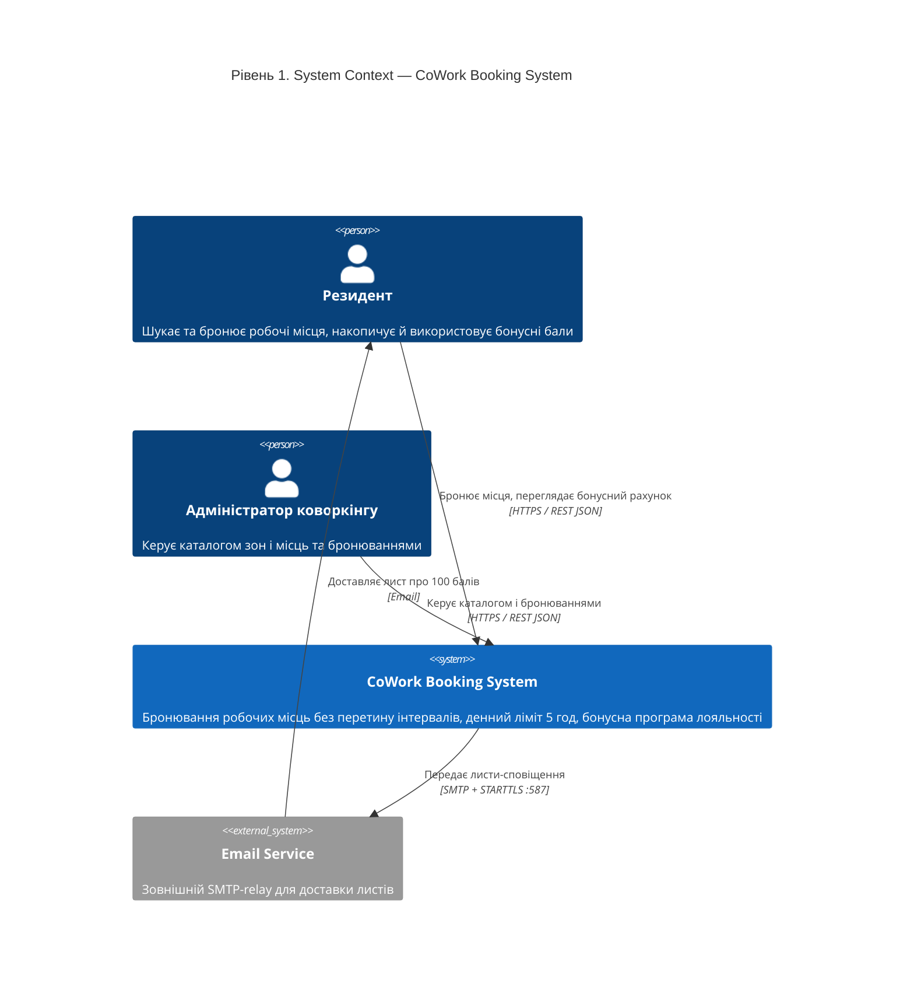
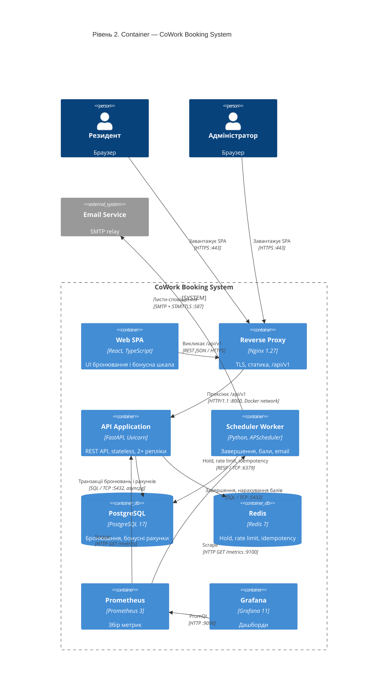
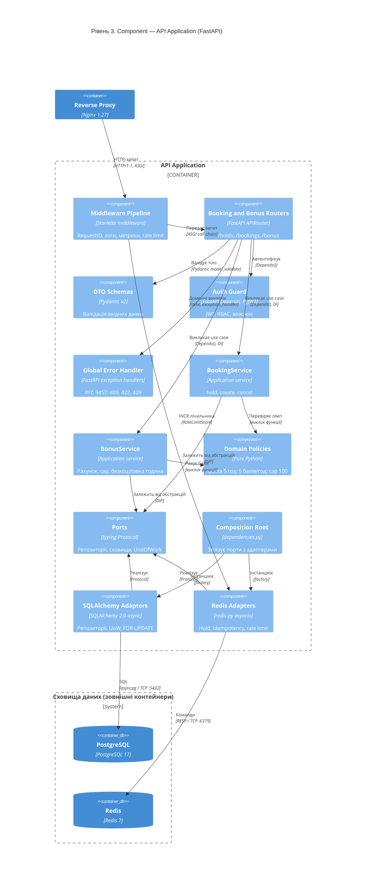

# РОЗДІЛ 2. ПРОЄКТУВАННЯ АРХІТЕКТУРИ СИСТЕМИ

Архітектуру спроєктовано за методологією C4 Model (Simon Brown) на основі контракту вимог [SRS](srs.md) за принципом Diagrams-as-Code: діаграми описано мовою Mermaid.js і рендеряться безпосередньо інтерфейсом GitHub. Ключові компроміси зафіксовано в [ADR](adr/README.md).

## 2.1 Контекстне та контейнерне моделювання системи (C4 Model)

### 2.1.1 Рівень 1. System Context Diagram

**Опис вузлів і зв'язків (Рівень 1):**

| Елемент | Тип | Опис | Вимоги |
| --- | --- | --- | --- |
| Резидент | Person | Користувач з роллю `user`: пошук, бронювання, бонусний рахунок | [SRS-FUN-09](srs.md#srs-fun-09)–[SRS-FUN-22](srs.md#srs-fun-22) |
| Адміністратор коворкінгу | Person | Користувач з роллю `admin`: каталог і всі бронювання | [SRS-FUN-06](srs.md#srs-fun-06)–[SRS-FUN-08](srs.md#srs-fun-08), [SRS-FUN-16](srs.md#srs-fun-16) |
| CoWork Booking System | System | Система, що розробляється | [SRS](srs.md) |
| Email Service | System_Ext | Зовнішній SMTP-relay; система не зберігає пошту | [SRS-FUN-24](srs.md#srs-fun-24) |

| Зв'язок | Протокол | Обґрунтування |
| --- | --- | --- |
| Резидент / Адміністратор → System | HTTPS (TLS 1.2+) / REST JSON | [SRS-NFR-SEC-03](srs.md#srs-nfr-sec-03) |
| System → Email Service | SMTP + STARTTLS, порт 587 | Шифрування каналу передачі листів |
| Email Service → Резидент | Email (доставка поштовою інфраструктурою) | Поза межами системи |

### 2.1.2 Рівень 2. Container Diagram

**Опис контейнерів (Рівень 2).** Кожен контейнер — окремий сервіс Docker Compose.

| Контейнер | Технологія | Відповідальність | Вимоги |
| --- | --- | --- | --- |
| Web SPA | React, TypeScript, Vite (статичний бандл) | Пошук місць, hold, бронювання, бонусна шкала 0–100 %, діалог `BONUS_CAP_REACHED` з діями «Використати зараз» / «Залишити» | [SRS-FUN-19](srs.md#srs-fun-19), [SRS-FUN-20](srs.md#srs-fun-20) |
| Reverse Proxy | Nginx 1.27 | Термінація TLS, HSTS, роздача статики SPA, проксіювання `/api/v1`, ліміт розміру тіла запиту | [SRS-NFR-SEC-03](srs.md#srs-nfr-sec-03) |
| API Application | Python 3.12, FastAPI, Uvicorn | REST API модулів Auth, Workspaces, Bookings, Bonus, Admin; stateless; 2+ репліки | [SRS-FUN-01](srs.md#srs-fun-01)–[SRS-FUN-16](srs.md#srs-fun-16), [SRS-FUN-19](srs.md#srs-fun-19)–[SRS-FUN-23](srs.md#srs-fun-23), [SRS-NFR-SCAL-01](srs.md#srs-nfr-scal-01) |
| Scheduler Worker | Python 3.12, APScheduler (та сама кодова база, інша точка входу) | Завершення бронювань, нарахування балів, email-сповіщення; запускається в одному екземплярі, захист від паралельних запусків — `FOR UPDATE SKIP LOCKED` | [SRS-FUN-17](srs.md#srs-fun-17), [SRS-FUN-18](srs.md#srs-fun-18), [SRS-FUN-24](srs.md#srs-fun-24), [SRS-NFR-REL-05](srs.md#srs-nfr-rel-05) |
| PostgreSQL | PostgreSQL 17 + `btree_gist` | Джерело істини: бронювання з `EXCLUDE USING gist`, бонусні рахунки з `CHECK`, журнал транзакцій з `UNIQUE` | [SRS-FUN-11](srs.md#srs-fun-11), [SRS-NFR-CONS-01](srs.md#srs-nfr-cons-01), [ADR-001](adr/0001-choice-of-technology.md), [ADR-002](adr/0002-bonus-wallet-model.md) |
| Redis | Redis 7 | Hold (`SET NX PX`), лічильники rate limit, ключі idempotency, кеш доступності; не є джерелом істини | [SRS-FUN-10](srs.md#srs-fun-10), [SRS-FUN-12](srs.md#srs-fun-12), [SRS-NFR-SCAL-02](srs.md#srs-nfr-scal-02), [ADR-001](adr/0001-choice-of-technology.md) |
| Prometheus | Prometheus 3 | Збір метрик з `/metrics` API і Worker | [SRS-NFR-OBS-02](srs.md#srs-nfr-obs-02) |
| Grafana | Grafana 11 | Дашборди RED і бізнес-метрик бонусної програми | [SRS-NFR-OBS-02](srs.md#srs-nfr-obs-02) |

**Специфікація зв'язків (Рівень 2):**

| Від → До | Протокол / порт | Призначення |
| --- | --- | --- |
| Резидент, Адміністратор → Reverse Proxy | HTTPS :443 | Завантаження SPA і виклики API |
| Web SPA → Reverse Proxy | REST JSON / HTTPS, `Authorization: Bearer <JWT>` | Виклики `/api/v1/*` |
| Reverse Proxy → API Application | HTTP/1.1 :8000 (внутрішня мережа Docker) | Проксіювання з заголовками `X-Request-ID`, `X-Forwarded-For` |
| API Application → PostgreSQL | SQL / TCP :5432 (asyncpg) | Транзакції бронювань і рахунків |
| API Application → Redis | RESP / TCP :6379 | Hold, rate limit, idempotency |
| Scheduler Worker → PostgreSQL | SQL / TCP :5432 | Завершення бронювань, нарахування балів |
| Scheduler Worker → Email Service | SMTP + STARTTLS :587 | Сповіщення про 100 балів |
| Prometheus → API Application, Scheduler Worker | HTTP GET `/metrics` (pull) | Збір метрик |
| Grafana → Prometheus | HTTP :9090, PromQL | Побудова дашбордів |

## 2.2 Компонентне моделювання критичного сервісу системи

Для декомпозиції обрано контейнер **API Application**, оскільки він містить усю логіку конкурентного бронювання та бонусної програми. Внутрішня структура відповідає Clean Architecture: вхідний шар → прикладні сервіси → доменні політики, а інфраструктура підключається через порти (Dependency Inversion).

**Опис компонентів (Рівень 3):**

| Шар | Компонент | Роль | Взаємодія | Вимоги |
| --- | --- | --- | --- | --- |
| Inbound | Middleware Pipeline | Генерація `request_id`, JSON-журналювання, метрики Prometheus, rate limit | Ланцюжок ASGI middleware; лічильник у Redis через `RateLimitStore` | [SRS-NFR-OBS-01](srs.md#srs-nfr-obs-01), [SRS-NFR-OBS-02](srs.md#srs-nfr-obs-02), [SRS-NFR-SCAL-02](srs.md#srs-nfr-scal-02) |
| Inbound | Booking and Bonus Routers | Ендпоїнти `POST /holds`, `POST /bookings`, `PATCH /bookings/{id}`, `GET /bonus/wallets/{coworking_id}`, `POST /bonus/redemptions` | Отримують сервіси та guard через `Depends()`; не мають доступу до БД | [SRS-FUN-10](srs.md#srs-fun-10)–[SRS-FUN-15](srs.md#srs-fun-15), [SRS-FUN-19](srs.md#srs-fun-19)–[SRS-FUN-22](srs.md#srs-fun-22) |
| Inbound | DTO Schemas | Валідація: тривалість 1–5 год, початок кратний 30 хв, ISO 8601; модель відповіді з полем `warnings` | `model_validate` до виклику сервісу; помилка → 422 | [SRS-FUN-13](srs.md#srs-fun-13), [SRS-FUN-20](srs.md#srs-fun-20), [SRS-FUN-21](srs.md#srs-fun-21) |
| Inbound | Auth Guard | Перевірка підпису та `exp` JWT, ролі (`user`/`admin`) і власника ресурсу | Залежність FastAPI `Depends(current_user)` | [SRS-FUN-04](srs.md#srs-fun-04), [SRS-NFR-SEC-01](srs.md#srs-nfr-sec-01), [SRS-NFR-SEC-04](srs.md#srs-nfr-sec-04) |
| Inbound | Global Error Handler | Мапінг доменних винятків у RFC 9457 Problem Details: `BookingConflict` → 409, `DailyLimitExceeded` → 422, `RateLimited` → 429 | `app.add_exception_handler`; приховує стек викликів | [SRS-FUN-11](srs.md#srs-fun-11), [SRS-FUN-14](srs.md#srs-fun-14) |
| Core | BookingService | Use cases hold / create / cancel; відкриває UnitOfWork, блокує рядок рахунку, перевіряє ліміт | Залежить лише від портів і політик | [SRS-FUN-10](srs.md#srs-fun-10)–[SRS-FUN-15](srs.md#srs-fun-15), [ADR-001](adr/0001-choice-of-technology.md) |
| Core | BonusService | Стан рахунку, попередження `BONUS_CAP_REACHED` / `BONUS_CAP_PARTIAL`, активація безкоштовної години, відновлення балансу | Залежить лише від портів і політик | [SRS-FUN-19](srs.md#srs-fun-19)–[SRS-FUN-23](srs.md#srs-fun-23), [ADR-002](adr/0002-bonus-wallet-model.md) |
| Core | Domain Policies | Чисті функції: `QuotaPolicy` (≤ 5 год/добу, [SRS-BR-02](srs.md#srs-br-02)), `BonusPolicy` (`min(5h, 100 − b)`, [SRS-BR-03](srs.md#srs-br-03), [SRS-BR-04](srs.md#srs-br-04)) | Виклик функції без I/O; покриття тестами ≥ 90 % | [SRS-NFR-MAINT-01](srs.md#srs-nfr-maint-01) |
| Core | Ports | Інтерфейси `BookingRepository`, `WalletRepository`, `HoldStore`, `IdempotencyStore`, `RateLimitStore`, `UnitOfWork` | `typing.Protocol`; реалізуються адаптерами | — |
| Wiring | Composition Root | Створення адаптерів і передача їх сервісам | Фабрики FastAPI-залежностей (`dependencies.py`) | — |
| Outbound | SQLAlchemy Adapters | Репозиторії, UnitOfWork (AsyncSession), `SELECT … FOR UPDATE`, мапінг SQLSTATE `23P01` → `BookingConflict` | SQL / asyncpg → PostgreSQL | [SRS-FUN-11](srs.md#srs-fun-11), [SRS-NFR-CONS-01](srs.md#srs-nfr-cons-01), [SRS-NFR-CONS-02](srs.md#srs-nfr-cons-02) |
| Outbound | Redis Adapters | `HoldStore` (`SET NX PX`, Lua-зняття з перевіркою токена), `IdempotencyStore` (TTL 24 год), `RateLimitStore` | RESP → Redis; за недоступності — `HoldUnavailable` → 503 | [SRS-FUN-10](srs.md#srs-fun-10), [SRS-FUN-12](srs.md#srs-fun-12), [SRS-NFR-REL-02](srs.md#srs-nfr-rel-02) |

**Потік `POST /api/v1/bookings`:** Middleware (request_id, rate limit) → Router → DTO-валідація → Auth Guard → `BookingService.create` → `IdempotencyStore.get` → UnitOfWork: блокування рядка `bonus_wallets` → `QuotaPolicy.check` → `BookingRepository.add` (обмеження `EXCLUDE`) → COMMIT → `HoldStore.release` → `BonusService.cap_warnings` → відповідь 201 з `warnings[]`.

## 2.3 Документування архітектурних рішень (Architecture Decision Records)

| ID | Рішення | Статус | Вимоги |
| --- | --- | --- | --- |
| [ADR-001](adr/0001-choice-of-technology.md) | Механізм запобігання подвійному бронюванню: PostgreSQL `EXCLUDE USING gist` + Redis hold | Approved | [SRS-FUN-10](srs.md#srs-fun-10), [SRS-FUN-11](srs.md#srs-fun-11), [SRS-NFR-CONS-01](srs.md#srs-nfr-cons-01), [SRS-NFR-PERF-02](srs.md#srs-nfr-perf-02), [SRS-NFR-REL-02](srs.md#srs-nfr-rel-02) |
| [ADR-002](adr/0002-bonus-wallet-model.md) | Модель бонусного рахунку: баланс з `CHECK` + журнал транзакцій з `UNIQUE` | Approved | [SRS-FUN-14](srs.md#srs-fun-14), [SRS-FUN-18](srs.md#srs-fun-18)–[SRS-FUN-23](srs.md#srs-fun-23), [SRS-NFR-CONS-02](srs.md#srs-nfr-cons-02)–[SRS-NFR-CONS-04](srs.md#srs-nfr-cons-04) |

## 2.4 Матриця трасування вимог в архітектуру

| Вимоги | Контейнер ([L2](#diagram-level2)) | Компоненти ([L3](#diagram-level3)) | Рішення | Верифікація |
| --- | --- | --- | --- | --- |
| [SRS-FUN-01](srs.md#srs-fun-01)–[SRS-FUN-05](srs.md#srs-fun-05) | API Application | Routers, Auth Guard, SQLAlchemy Adapters | — | Pytest + HTTPX |
| [SRS-FUN-06](srs.md#srs-fun-06)–[SRS-FUN-09](srs.md#srs-fun-09) | API Application, PostgreSQL | Routers, DTO Schemas, SQLAlchemy Adapters | — | Pytest + HTTPX |
| [SRS-FUN-10](srs.md#srs-fun-10), [SRS-FUN-12](srs.md#srs-fun-12) | API Application, Redis | BookingService, Redis Adapters | [ADR-001](adr/0001-choice-of-technology.md) | Pytest, fault injection |
| [SRS-FUN-11](srs.md#srs-fun-11) | API Application, PostgreSQL | BookingService, SQLAlchemy Adapters, Global Error Handler | [ADR-001](adr/0001-choice-of-technology.md) | k6 (100 VU) + SQL |
| [SRS-FUN-13](srs.md#srs-fun-13), [SRS-FUN-14](srs.md#srs-fun-14) | API Application, PostgreSQL | DTO Schemas, Domain Policies, BookingService | [ADR-002](adr/0002-bonus-wallet-model.md) | Pytest, Hypothesis |
| [SRS-FUN-15](srs.md#srs-fun-15), [SRS-FUN-16](srs.md#srs-fun-16) | API Application | Routers, Auth Guard, BookingService | — | Pytest + HTTPX |
| [SRS-FUN-17](srs.md#srs-fun-17), [SRS-FUN-18](srs.md#srs-fun-18), [SRS-FUN-24](srs.md#srs-fun-24) | Scheduler Worker, PostgreSQL, Email Service | Domain Policies (спільний модуль) | [ADR-002](adr/0002-bonus-wallet-model.md) | Pytest + freezegun, Mailpit |
| [SRS-FUN-19](srs.md#srs-fun-19)–[SRS-FUN-23](srs.md#srs-fun-23) | Web SPA, API Application, PostgreSQL | BonusService, Domain Policies, SQLAlchemy Adapters | [ADR-002](adr/0002-bonus-wallet-model.md) | Pytest, asyncio.gather |
| [SRS-NFR-PERF-01](srs.md#srs-nfr-perf-01)–[SRS-NFR-PERF-03](srs.md#srs-nfr-perf-03), [SRS-NFR-SCAL-01](srs.md#srs-nfr-scal-01) | Reverse Proxy, API Application | Middleware Pipeline | [ADR-001](adr/0001-choice-of-technology.md) | k6 |
| [SRS-NFR-SEC-01](srs.md#srs-nfr-sec-01)–[SRS-NFR-SEC-06](srs.md#srs-nfr-sec-06) | Reverse Proxy, API Application | Auth Guard, Middleware Pipeline | — | OWASP ZAP, Trivy, Bandit, gitleaks |
| [SRS-NFR-OBS-01](srs.md#srs-nfr-obs-01), [SRS-NFR-OBS-02](srs.md#srs-nfr-obs-02) | API Application, Scheduler Worker, Prometheus, Grafana | Middleware Pipeline | — | Pytest, `/metrics` |
